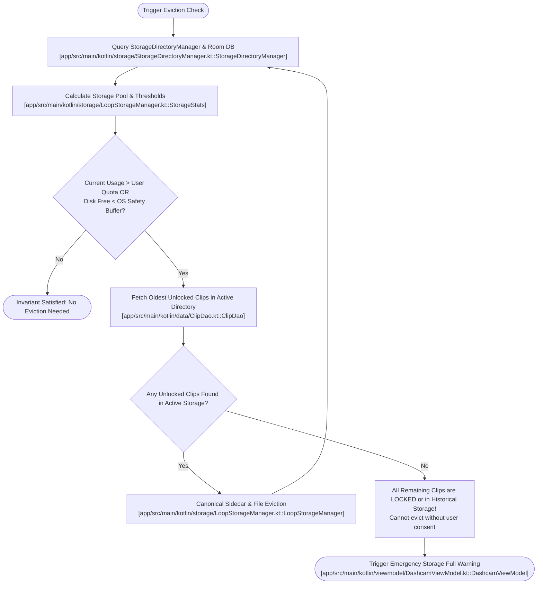
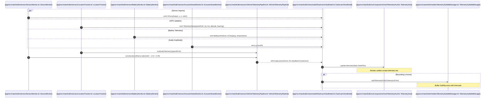
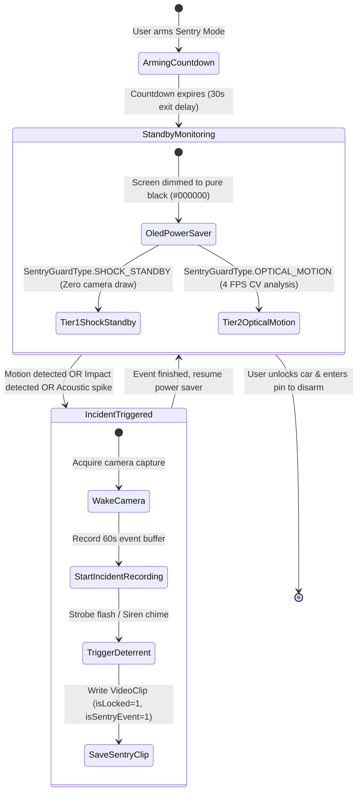
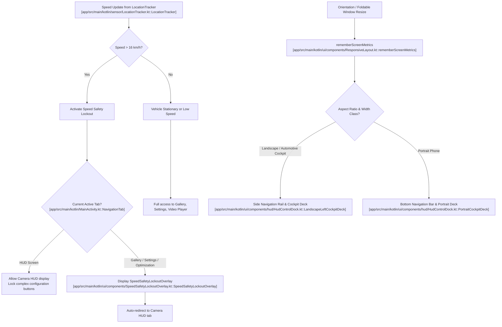
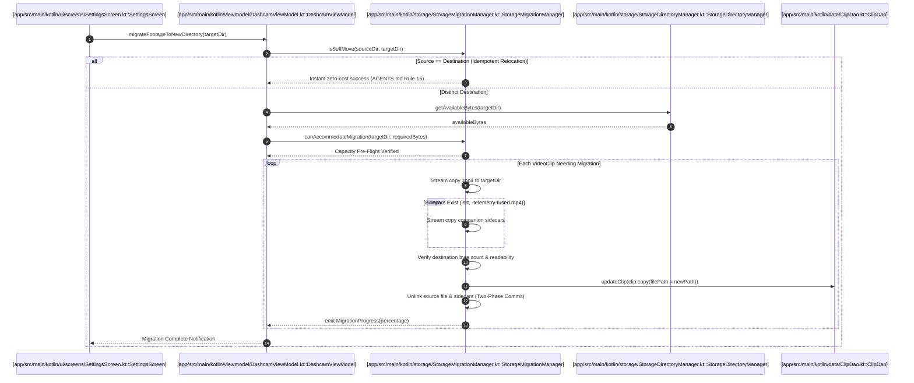

# ARCHITECTURE_FLOW.md — DashGuard-Pro Runtime Execution & Data Flows

This document details the primary runtime execution flows, data transformation pipelines, and lifecycle state machines of DashGuard-Pro.
All entities in sequence descriptions and Mermaid diagrams reference exact semantic tags defined in [CODEBASE_MAP.md](CODEBASE_MAP.md) using the canonical tag format: `[repository-relative/path/FileName.ext::EntityName]`.

---

## ⚠️ Critical Synchronization Invariant
Every tag appearing in `ARCHITECTURE_FLOW.md` **MUST exist exactly in `CODEBASE_MAP.md`**.
Do not create shortened, renamed, or alternative versions of tags.
Every sequence participant and flowchart node must resolve to a valid canonical tag in the codebase map.

---

## 1. Recording Session Lifecycle & Seamless Loop Rotation

### 1.1 Trigger & Entry Point
- **Trigger**: User taps the shutter toggle button on the Camera HUD, or auto-start is triggered on application startup when enabled in settings.
- **Entry Points**: 
  - UI: `[app/src/main/kotlin/ui/screens/CameraHudScreen.kt::CameraHudScreen]` (Record Button click event)
  - Orchestration: `[app/src/main/kotlin/viewmodel/DashcamViewModel.kt::DashcamViewModel]` (`toggleRecording()`)

### 1.2 Pre-Conditions & Invariants
1. Camera permission (`android.permission.CAMERA`) and Audio recording permission (`android.permission.RECORD_AUDIO`) are granted.
2. `[app/src/main/kotlin/camera/CameraXRecordingManager.kt::CameraXRecordingManager]` has completed camera binding (`awaitCameraBinding()` resolves).
3. Primary storage directory is resolved and accessible via `[app/src/main/kotlin/storage/StorageDirectoryManager.kt::StorageDirectoryManager]`.
4. Pre-flight storage capacity check via `[app/src/main/kotlin/storage/StorageDirectoryManager.kt::StorageDirectoryManager]` confirms directory is writable and device free space is strictly above the dynamic OS safety buffer (`clamp(500 MB, totalPartitionBytes * 0.02, 5 GB)`) (AGENTS.md Rule 10).
5. Lifecycle serialization mutex `recordingLifecycleMutex` in `[app/src/main/kotlin/camera/RecordingSessionCoordinator.kt::RecordingSessionCoordinator]` (exposed via `[app/src/main/kotlin/viewmodel/DashcamViewModel.kt::DashcamViewModel]`) prevents overlapping start/stop invocations (AGENTS.md Rule 4 & Rule 9).

### 1.3 Sequence Diagram
```mermaid
sequenceDiagram
    autonumber
    participant UI as [app/src/main/kotlin/ui/screens/CameraHudScreen.kt::CameraHudScreen]
    participant VM as [app/src/main/kotlin/viewmodel/DashcamViewModel.kt::DashcamViewModel]
    participant COORD as [app/src/main/kotlin/camera/RecordingSessionCoordinator.kt::RecordingSessionCoordinator]
    participant SVC as [app/src/main/kotlin/service/DashcamForegroundService.kt::DashcamForegroundService]
    participant REC as [app/src/main/kotlin/camera/CameraXRecordingManager.kt::CameraXRecordingManager]
    participant DIR as [app/src/main/kotlin/storage/StorageDirectoryManager.kt::StorageDirectoryManager]
    participant SUB as [app/src/main/kotlin/media/TelemetrySubtitleManager.kt::TelemetrySubtitleManager]
    participant LOOP as [app/src/main/kotlin/storage/LoopStorageManager.kt::LoopStorageManager]
    participant DAO as [app/src/main/kotlin/data/ClipDao.kt::ClipDao]

    UI->>VM: toggleRecording()
    VM->>COORD: toggleRecording()
    COORD->>COORD: acquire recordingLifecycleMutex
    COORD->>DIR: isStorageWritable(targetDir) & getAvailableBytes(targetDir) vs getOsSafetyBufferBytes(targetDir)
    DIR-->>COORD: Pre-flight Storage OK (Free space > OS safety buffer)
    COORD->>SVC: DashcamForegroundService.startService()
    Note over SVC: Foreground notification posted immediately in onCreate()
    COORD->>DIR: resolveStorageDirectory()
    DIR-->>COORD: targetDir (File)
    COORD->>LOOP: createNewVideoFileWithTimestamp("DASH")
    LOOP-->>COORD: targetFile (.mp4)
    COORD->>REC: startRecording(targetFile, audioEnabled)
    REC-->>COORD: Recording active (VideoRecordEvent.Start)
    COORD->>COORD: Allocate ActiveSegmentData(targetFile)
    
    loop Every 1.0 Second
        COORD->>COORD: Buffer TelemetryPoint in memory (ActiveSegmentData)
    end

    Note over COORD,REC: Segment Interval Elapsed (3m / 5m)
    COORD->>REC: rotateToNextChunk()
    REC-->>COORD: onSegmentFinalized (activeFile)
    COORD->>SUB: writeSubtitleFile(srtFile, pointsToSave)
    SUB-->>COORD: Finalize .srt sidecar
    COORD->>DAO: insertClip([app/src/main/kotlin/model/VideoClip.kt::VideoClip])
    COORD->>LOOP: performLoopCleanupIfNeeded()
    COORD->>LOOP: createNewVideoFileWithTimestamp("DASH")
    LOOP-->>COORD: nextTargetFile (.mp4)
    COORD->>REC: startRecording(nextTargetFile, audioEnabled)
```

### 1.4 Step-by-Step Execution Trace
1. **Invocation & Mutex Gate**: `[app/src/main/kotlin/ui/screens/CameraHudScreen.kt::CameraHudScreen]` triggers `[app/src/main/kotlin/viewmodel/DashcamViewModel.kt::DashcamViewModel]` via `toggleRecording()`, which delegates directly to `[app/src/main/kotlin/camera/RecordingSessionCoordinator.kt::RecordingSessionCoordinator]`. The coordinator serializes startup/teardown deterministically via `recordingLifecycleMutex`, cancels any pending in-flight startup coroutine if stop is requested mid-transition, and tracks monotonic recording generations to discard stale completion events (AGENTS.md Rule 4 & Rule 9).
2. **Foreground Service Promotion**: If starting, `[app/src/main/kotlin/service/DashcamForegroundService.kt::DashcamForegroundService]` is started with `startForegroundService`. The service promotes itself immediately to foreground in `onCreate()` with an initial ongoing notification and explicitly declared foreground service types (`CAMERA | LOCATION | DATA_SYNC`), fulfilling the Android OS contract, satisfying Android 14+ background access policies, and eliminating `ForegroundServiceDidNotStartInTimeException` risks (AGENTS.md Rule 9 & Rule 18).
3. **Hardware Configuration**: `[app/src/main/kotlin/camera/CameraHardwareSpecManager.kt::CameraHardwareSpecManager]` queries Camera2 characteristics to select optimal FPS ranges (e.g., 30 or 60 FPS) and stabilization modes.
4. **Target File Creation**: `[app/src/main/kotlin/storage/StorageDirectoryManager.kt::StorageDirectoryManager]` and `[app/src/main/kotlin/storage/LoopStorageManager.kt::LoopStorageManager]` allocate an absolute collision-free path (e.g., `VID_DASH_YYYYMMDD_HHMMSS.mp4`).
5. **Segment Capture**: `[app/src/main/kotlin/camera/CameraXRecordingManager.kt::CameraXRecordingManager]` configures the CameraX `VideoCapture` use case and binds output to the target file (with audio recording configured via `[app/src/main/kotlin/ui/components/settings/DashcamSettingsSection.kt::RecordingMediaSettingsSection]`). Concurrently, `[app/src/main/kotlin/system/SystemDiagnosticsManager.kt::SystemDiagnosticsManager]` applies auto-DND if enabled in settings to suppress notification disruptions.
6. **Telemetry In-Memory Buffer Initialization**: `[app/src/main/kotlin/camera/RecordingSessionCoordinator.kt::RecordingSessionCoordinator]` instantiates `ActiveSegmentData` holding an in-memory mutable list of `[app/src/main/kotlin/media/TelemetrySubtitleManager.kt::TelemetryPoint]` instances paired to the video file name.
7. **Periodic Subtitle Ingestion**: Every second during recording, sensor and location samples are converted to `[app/src/main/kotlin/media/TelemetrySubtitleManager.kt::TelemetryPoint]` and buffered in RAM without continuous flash I/O (AGENTS.md Rule 16.3).
8. **Segment Rollover (Loop vs. Standby Override vs. Deferred Actions)**:
   - When segment duration expires:
   - `[app/src/main/kotlin/camera/CameraXRecordingManager.kt::CameraXRecordingManager]` stops current output stream and triggers `onSegmentFinalized`.
   - `[app/src/main/kotlin/media/TelemetrySubtitleManager.kt::TelemetrySubtitleManager]` flushes the buffered points to the `.srt` sidecar file on disk via `writeSubtitleFile(srtFile, pointsToSave)`.
   - A `[app/src/main/kotlin/model/VideoClip.kt::VideoClip]` metadata entity is committed to SQLite via `[app/src/main/kotlin/data/ClipDao.kt::ClipDao]`.
   - `[app/src/main/kotlin/storage/LoopStorageManager.kt::LoopStorageManager]` runs post-flight eviction checks.
   - **Branching via `[app/src/main/kotlin/viewmodel/state/DashcamUiState.kt::RecordingOriginState]` and `[app/src/main/kotlin/system/PowerAndThermalCoordinator.kt::PendingPostLockAction]`**:
     - If `hasPendingPostLockAction()` is active (e.g. power loss shutdown, sentry arming on power loss, thermal cooling sleep, low battery sleep occurred while an emergency clip was recording): engine halts recording and calls `executePendingPostLockAction()` to perform the queued state transition safely (AGENTS.md Rule 7, 9, 12).
     - If `DRIVING_LOOP`: recording engine immediately starts next segment file with minimal inter-frame gap.
     - If `STANDBY` (discrete incident override): engine stops recording and returns cleanly to idle Standby (AGENTS.md Rule 9).
     - If `pendingThermalSleep` was armed: engine stops recording and enters Thermal Cooling Sleep (`DeviceSleepMode.THERMAL_COOLING`).

---

## 2. Storage Quota & Retention Eviction Pipeline

### 2.1 Trigger & Entry Point
- **Trigger**: (a) End of each video segment recording / rollover; (b) App startup; (c) User modifies storage quota in Settings (`[app/src/main/kotlin/ui/screens/SettingsScreen.kt::SettingsScreen]` via `[app/src/main/kotlin/ui/components/settings/StorageSettingsSection.kt::StorageSettingsSection]`); (d) Storage capacity reconciliation during active recording.
- **Entry Point**: `[app/src/main/kotlin/storage/LoopStorageManager.kt::LoopStorageManager]` (`performLoopCleanupIfNeeded()`).

### 2.2 Pre-Conditions
1. Storage location configured in `[app/src/main/kotlin/data/SettingsRepository.kt::SettingsRepository]`.
2. Storage path accessible via `[app/src/main/kotlin/storage/StorageDirectoryManager.kt::StorageDirectoryManager]`.
3. Room database accessible via `[app/src/main/kotlin/data/ClipDao.kt::ClipDao]`.

### 2.3 Flowchart Diagram


### 2.4 Step-by-Step Execution Trace
1. **Authoritative Capacity Query**: `[app/src/main/kotlin/storage/LoopStorageManager.kt::LoopStorageManager]` queries `[app/src/main/kotlin/storage/StorageDirectoryManager.kt::StorageDirectoryManager]` for authoritative filesystem capacity and free space (`getAvailableBytes`, `getTotalBytes`), eliminating duplicate local `StatFs` invocations, while filtering active directory files strictly via `[app/src/main/kotlin/util/FileExtensions.kt::File.isDashGuardRecordingFile]`.
2. **Stable Pool Calculation**: Stable Pool = `freeBytes + appUsedBytes`. The OS safety buffer is dynamically computed via `getOsSafetyBufferBytes(dir)`: `clamp(500 MB, totalPartitionBytes * 0.02, 5 GB)` (AGENTS.md Rule 10), and communicated to users via `[app/src/main/kotlin/ui/components/settings/StorageLocationDialogs.kt::StorageQuotaInfoDialog]`.
3. **Candidate Identification**:
   - Executes query via `[app/src/main/kotlin/data/ClipDao.kt::ClipDao]` to fetch clips ordered by `timestamp ASC` where `isLocked == 0`.
   - **Active Directory Partitioning**: Scopes candidate clips strictly to those residing in the active storage directory via `[app/src/main/kotlin/storage/StorageMigrationManager.kt::StorageMigrationManager]` (`getClipsInDirectory`), guaranteeing historical footage residing in older or external directories is safely preserved and never deleted by active quota reclamation.
   - **Protection Rule**: Any clip marked `isLocked == 1` (incidents, sentry triggers, manual locks) or any non-app foreign file failing `[app/src/main/kotlin/util/FileExtensions.kt::File.isDashGuardRecordingFile]` is excluded from automatic deletion.
4. **Physical File, Sidecar, and DB Eviction**:
   - Invokes `deleteClipAndSidecars(clip)` via `[app/src/main/kotlin/storage/LoopStorageManager.kt::LoopStorageManager.deleteClipAndSidecars]` on `[app/src/main/kotlin/storage/LoopStorageManager.kt::LoopStorageManager]`.
   - Symmetrically deletes the primary `.mp4` video, paired SubRip (`.srt`) subtitle sidecar, and any `-telemetry-fused.mp4` transcoded derivatives before purging the record from `[app/src/main/kotlin/data/ClipDao.kt::ClipDao]`.
   - **Protection Rule**: Any clip marked `isLocked == 1` is strictly preserved unless `forceDeleteLocked == true` is explicitly provided by user-initiated purge actions.
5. **Hysteresis Loop Termination**: Repeats deletion (and Pass 2 orphan DashGuard file cleanup for untracked app files > 120s old) until total usage drops below configured target hysteresis threshold or minimum safe disk space.
6. **UI Notification**: Emits updated `[app/src/main/kotlin/storage/LoopStorageManager.kt::StorageStats]` consumed by `[app/src/main/kotlin/ui/components/gallery/StorageBar.kt::StorageBar]`.

---

## 3. Telemetry Acquisition & Sensor Fusion Stream

### 3.1 Trigger & Ingress Sources
- **Trigger**: Continuous hardware sampling active while recording or displaying the Camera HUD screen.
- **Ingress Sources**:
  - Motion / G-Force: `[app/src/main/kotlin/sensor/SensorMonitor.kt::SensorMonitor]`
  - GPS / Speed: `[app/src/main/kotlin/sensor/LocationTracker.kt::LocationTracker]`
  - Battery / Thermal: `[app/src/main/kotlin/sensor/BatteryMonitor.kt::BatteryMonitor]`
  - Audio Decibels: `[app/src/main/kotlin/sensor/AcousticNoiseMonitor.kt::AcousticNoiseMonitor]`

### 3.2 Sequence Diagram


### 3.3 Step-by-Step Execution Trace
1. **Sensor Ingress**:
   - `[app/src/main/kotlin/sensor/SensorMonitor.kt::SensorMonitor]` listens on `Sensor.TYPE_ACCELEROMETER`, computes total G magnitude `sqrt(x^2 + y^2 + z^2) / 9.80665`, emits `[app/src/main/kotlin/sensor/SensorMonitor.kt::GForceData]`, and throttles UI state emissions (2Hz rate-limited or > 0.2G delta) to prevent main-thread recomposition churn (AGENTS.md Rule 16.3).
   - `[app/src/main/kotlin/sensor/LocationTracker.kt::LocationTracker]` registers with Android `LocationManager` requesting high-accuracy `GPS_PROVIDER` updates at 1000ms intervals (with `NETWORK_PROVIDER` fallback), flushing stale callbacks via `removeUpdates` beforehand and fusing GPS bearing with magnetometer rotation vector to emit `[app/src/main/kotlin/sensor/LocationTracker.kt::TelemetryData]`.
   - `[app/src/main/kotlin/sensor/BatteryMonitor.kt::BatteryMonitor]` receives sticky broadcasts for `ACTION_BATTERY_CHANGED` to deliver `[app/src/main/kotlin/sensor/BatteryMonitor.kt::BatteryInfo]` and `[app/src/main/kotlin/sensor/BatteryMonitor.kt::PowerSource]`, classifying thermal tiers into canonical `[app/src/main/kotlin/sensor/BatteryMonitor.kt::TemperatureStatus]`.
   - `[app/src/main/kotlin/sensor/AcousticNoiseMonitor.kt::AcousticNoiseMonitor]` samples audio buffer RMS amplitude when mic permission is available.
2. **ViewModel Ingestion & Driving Safety Evaluation**:
   - `[app/src/main/kotlin/viewmodel/DashcamViewModel.kt::DashcamViewModel]` ingests streams via Kotlin Coroutines `StateFlow`.
   - Delegates driving safety lockout arbitration to `[app/src/main/kotlin/sensor/VehicleTelemetryPipeline.kt::VehicleTelemetryPipeline]`, which corroborates GPS velocity with accelerometer G-force stillness across a 5-second deadband window to prevent premature UI unlocking during tunnel GPS dropouts.
   - Normalizes speed according to user unit preference (`KMH` or `MPH`) from `[app/src/main/kotlin/data/settings/DashGuardSettings.kt::SpeedUnit]`.
3. **Reactive UI Rendering**:
   - `[app/src/main/kotlin/ui/components/hud/TelemetryHud.kt::TelemetryHud]` renders consolidated top bar displaying speed, compass bearing, battery percentage, thermal status, and recording timer.
4. **Telemetry Serialization**:
   - During recording, `[app/src/main/kotlin/media/TelemetrySubtitleManager.kt::TelemetrySubtitleManager]` compiles raw samples into SubRip entries structured as `[app/src/main/kotlin/media/TelemetrySubtitleManager.kt::TelemetrySubtitleEntry]`.

---

## 4. Incident Detection & Emergency Lock

### 4.1 Trigger & Entry Point
- **Triggers**:
  - G-force magnitude exceeds sensitivity threshold defined by `[app/src/main/kotlin/data/settings/DashGuardSettings.kt::Sensitivity]`.
  - Acoustic collision detection (decibel level exceeds threshold in Sentry mode).
  - Manual driver tap on the Emergency Lock button in the HUD or hardware volume key press (`[app/src/main/kotlin/MainActivity.kt::MainActivity.onKeyDown]`).
- **Entry Points**:
  - `[app/src/main/kotlin/viewmodel/DashcamViewModel.kt::DashcamViewModel]` (`lockCurrentClip()`, `toggleCurrentClipLock()`), delegating to `[app/src/main/kotlin/camera/RecordingSessionCoordinator.kt::RecordingSessionCoordinator]`.
  - Configuration: Incident guarantee window configured via `[app/src/main/kotlin/ui/components/settings/CustomThresholdDialogs.kt::CustomIncidentBufferDialog]` (15s to 300s / 5 mins).

### 4.2 Sequence Diagram
```mermaid
sequenceDiagram
    autonumber
    participant ACCEL as [app/src/main/kotlin/sensor/SensorMonitor.kt::SensorMonitor]
    participant UI as [app/src/main/kotlin/ui/screens/CameraHudScreen.kt::CameraHudScreen]
    participant VM as [app/src/main/kotlin/viewmodel/DashcamViewModel.kt::DashcamViewModel]
    participant COORD as [app/src/main/kotlin/camera/RecordingSessionCoordinator.kt::RecordingSessionCoordinator]
    participant PWR as [app/src/main/kotlin/system/PowerAndThermalCoordinator.kt::PowerAndThermalCoordinator]
    participant ALERT as [app/src/main/kotlin/feedback/AlertManager.kt::AlertManager]
    participant DAO as [app/src/main/kotlin/data/ClipDao.kt::ClipDao]
    participant LOOP as [app/src/main/kotlin/storage/LoopStorageManager.kt::LoopStorageManager]

    alt Hardware Trigger: G-Force Spike
        ACCEL->>VM: onImpactDetected(peakG = 2.8G)
        VM->>COORD: lockCurrentClip("Impact Detected")
    else Manual Driver Action
        UI->>VM: lockCurrentClip("Manual Driver Lock")
        VM->>COORD: lockCurrentClip("Manual Driver Lock")
    end

    COORD->>COORD: mark active segment locked & record incident telemetry
    COORD->>COORD: guaranteePostIncidentBuffer(ui.segmentSeconds)
    COORD->>PWR: onClipLocked()
    opt Running on Unplugged Battery or External Power Lost
        PWR->>PWR: setPendingPostLockPowerLoss() ([app/src/main/kotlin/system/PowerAndThermalCoordinator.kt::PendingPostLockAction])
    end
    
    COORD->>ALERT: playLockSound() & vibrateImpactPattern()
    ALERT-->>COORD: Feedback confirmed
    
    COORD->>VM: emit isSegmentLocked = true & lastTriggerReason
    VM->>UI: render emergency lock indicator and banner
    
    Note over COORD,DAO: At segment finalization, clip persisted with isLocked=1
    COORD->>DAO: insertClip([app/src/main/kotlin/model/VideoClip.kt::VideoClip])
    COORD->>LOOP: performLoopCleanupIfNeeded()
    Note over LOOP: Locked clips permanently excluded from FIFO loop eviction
    
    opt Has Pending Post-Lock Action ([app/src/main/kotlin/system/PowerAndThermalCoordinator.kt::PendingPostLockAction])
        COORD->>PWR: executePendingPostLockAction()
        PWR->>COORD: cleanly stop recording & transition to sleep / sentry
    end
```

### 4.3 Step-by-Step Execution Trace
1. **Impact Detection & Driver Intent**: Accelerometer vector magnitude `sqrt(x^2 + y^2 + z^2) / 9.80665` spikes beyond threshold configured in `[app/src/main/kotlin/ui/components/settings/DashcamSettingsSection.kt::SensorsSettingsSection]` (`[app/src/main/kotlin/data/settings/DashGuardSettings.kt::Sensitivity]`) in `[app/src/main/kotlin/sensor/SensorMonitor.kt::SensorMonitor]`, or the driver initiates a manual emergency lock via HUD button or hardware volume key (`[app/src/main/kotlin/MainActivity.kt::MainActivity.onKeyDown]`).
2. **Alert Dispatch & Feedback**: `[app/src/main/kotlin/camera/RecordingSessionCoordinator.kt::RecordingSessionCoordinator]` triggers `[app/src/main/kotlin/feedback/AlertManager.kt::AlertManager]` to play a distinct lock audio chime (`playLockSound()`) and haptic pattern (`vibrateImpactPattern()`). In Sentry mode, audio chimes are muted to eliminate acoustic actuator-to-sensor feedback loops.
3. **Guaranteed Post-Incident Buffer Window**:
   - `RecordingSessionCoordinator.guaranteePostIncidentBuffer()` dynamically extends `currentSegmentTargetSeconds` to guarantee that recording continues for at least `settings.incidentBufferSeconds` past the impact offset (customizable from 15s to 300s / 5 minutes via `[app/src/main/kotlin/ui/components/settings/CustomThresholdDialogs.kt::CustomIncidentBufferDialog]`).
   - Incident telemetry (GPS coordinates, timestamp offset, peak G-force) is stamped onto `ActiveSegmentData`.
4. **Standby Mode Emergency Recording Trigger**: If the lock button is pressed while the dashcam is in idle Standby, `[app/src/main/kotlin/camera/RecordingSessionCoordinator.kt::RecordingSessionCoordinator]` immediately initiates a new protected recording (`startRecording("Manual Emergency Lock")`) for the exact incident buffer duration, ensuring high-priority driver capture without manual multi-step arming.
5. **Dual-Coordinator Mutual Exclusion & On-Hold State Transitions (`PendingPostLockAction`)**:
   - `[app/src/main/kotlin/system/PowerAndThermalCoordinator.kt::PowerAndThermalCoordinator]` coordinates with `[app/src/main/kotlin/camera/RecordingSessionCoordinator.kt::RecordingSessionCoordinator]` via `onClipLocked()`.
   - If an external power loss occurs (vehicle unplugged), vehicle battery drops below safety floor, or device temperature exceeds maximum cutoff while an emergency clip is actively recording, the transition is queued via `[app/src/main/kotlin/system/PowerAndThermalCoordinator.kt::PendingPostLockAction]` (`POWER_LOSS_SHUTDOWN`, `SENTRY_ARM_ON_POWER_LOSS`, `THERMAL_COOLING_SLEEP`, or `LOW_BATTERY_SLEEP`).
   - The active video stream is physically shielded from premature abortion, allowing the guaranteed post-crash buffer to finish writing to flash. Once the segment finalizes, `executePendingPostLockAction()` is called to safely complete the deferred shutdown or sleep transition (AGENTS.md Rule 7, Rule 9, Rule 12).
6. **Storage Retention Immunity**: Upon finalization, the clip is inserted into `[app/src/main/kotlin/data/ClipDao.kt::ClipDao]` with `isLocked = true`. `[app/src/main/kotlin/storage/LoopStorageManager.kt::LoopStorageManager]` permanently protects the file from automated loop eviction. If an impact occurred within 15 seconds of a chunk boundary, the preceding clip is also marked locked in Room DB.

---

## 5. Sentry & Motion Detection Standby Workflow

### 5.1 Trigger & Entry Point
- **Trigger**: Sentry mode enabled when the vehicle is parked (manual toggle or auto-arm on power loss / recording stop configured via `[app/src/main/kotlin/data/settings/DashGuardSettings.kt::SentryArmingTrigger]`).
- **Entry Point**: `[app/src/main/kotlin/ui/components/settings/SentrySubMenuScreen.kt::SentrySubMenuScreen]`, `[app/src/main/kotlin/viewmodel/DashcamViewModel.kt::DashcamViewModel]` (`armSentryMode()`), delegating to `[app/src/main/kotlin/sentry/SentryController.kt::SentryController]` (`arm()`).

### 5.2 State Machine Diagram


### 5.3 Step-by-Step Execution Trace
1. **Arming Phase**: Sentry mode initiates an arming delay (e.g. 30 seconds) governed by `[app/src/main/kotlin/data/settings/DashGuardSettings.kt::SentryArmingTrigger]` (customizable via `[app/src/main/kotlin/ui/components/settings/CustomThresholdDialogs.kt::CustomSentryArmingDelayDialog]`) to allow driver exit, transitioning the controller state machine (`[app/src/main/kotlin/sentry/SentryController.kt::SentryState]`) from `DISARMED` to `ARMING` then `MONITORING`.
2. **Power Minimization**:
   - `[app/src/main/kotlin/ui/components/hud/OledPowerSaverOverlay.kt::OledPowerSaverOverlay]` draws an energy-efficient true-black (`#000000`) canvas.
   - `[app/src/main/kotlin/ui/components/hud/CameraPreviewView.kt::CameraPreviewView]` detaches the SurfaceView provider during OLED black state to stop GPU composition at the source (AGENTS.md Rule 16.2).
   - Battery level is guarded by `[app/src/main/kotlin/sensor/BatteryMonitor.kt::BatteryMonitor]`. If vehicle battery drops below configured limit, Sentry safely auto-demotes to Tier 1 or enters `DeviceSleepMode.LOW_BATTERY_STANDBY`.
3. **Surveillance Tiers & Hardware Settling**:
   - **Tier 1 (Shock & Acoustic)**: Selected via `[app/src/main/kotlin/data/settings/DashGuardSettings.kt::SentryGuardType]`. `[app/src/main/kotlin/sensor/SensorMonitor.kt::SensorMonitor]` runs low-power accelerometer monitoring and `[app/src/main/kotlin/sensor/AcousticNoiseMonitor.kt::AcousticNoiseMonitor]` listens for glass break / collision sounds. Camera sensor is completely unpowered. `AcousticNoiseMonitor` applies a 1.5s startup settling window to eliminate microphone turn-on clicks, and `[app/src/main/kotlin/camera/RecordingSessionCoordinator.kt::RecordingSessionCoordinator]` mutes all speaker chimes in Sentry mode to prevent acoustic actuator-to-sensor feedback loops.
   - **Tier 2 (Optical Motion)**: `[app/src/main/kotlin/camera/MotionDetectionAnalyzer.kt::MotionDetectionAnalyzer]` processes 4 FPS downscaled YUV frames using spatial block pooling (32x24 grid), global illumination compensation, and 8-neighbor spatial clustering. Crucially, upon analyzer arming or camera rebind, `resetTemporalHistory()` is called and 3 warm-up frames (`warmupFramesRemaining = 3`) are discarded to allow hardware auto-exposure (AE) and auto-white-balance (AWB) to settle, eliminating false motion triggers caused by sensor exposure hunting.
4. **Trigger Response & Post-Incident Settling Cooldown**:
   - When motion, impact, or noise breaches threshold:
   - `[app/src/main/kotlin/sentry/SentryController.kt::SentryController]` validates `canTriggerIncident()`, rejecting alerts if within the 4000ms post-incident settling cooldown window (`markIncidentCompleted()`, `resetCooldown()`). This prevents endless back-to-back incident capture loops.
   - `[app/src/main/kotlin/camera/CameraXRecordingManager.kt::CameraXRecordingManager]` captures a high-resolution sentry event clip (duration configurable via `[app/src/main/kotlin/ui/components/settings/CustomThresholdDialogs.kt::CustomSentryIncidentDurationDialog]`).
   - `[app/src/main/kotlin/feedback/AlertManager.kt::AlertManager]` activates configured deterrent (`[app/src/main/kotlin/data/settings/DashGuardSettings.kt::SentryDeterrentMode]`): screen strobe, audible chime/siren, or silent recording.
   - If an ongoing event recording is interrupted by early disarm or power failure, `[app/src/main/kotlin/data/settings/DashGuardSettings.kt::SentryInterruptedClipAction]` dictates whether to finalize or discard the fragment.
5. **In-Flight Incident Protection & Deferred Sleep Transitions**:
   - If vehicle battery drops below the low-battery cutoff or power is disconnected during an active Sentry incident capture, `[app/src/main/kotlin/system/PowerAndThermalCoordinator.kt::PendingPostLockAction]` defers the transition until the in-flight clip finishes writing to flash, guaranteeing evidence persistence before sleep admission (AGENTS.md Rule 7, 9, 12).
6. **Formal Low-Power Sleep, Hysteretic Auto-Promotion & Symmetrical Recovery**:
   - When `sentryAutoDemoteEnabled` is active and battery/thermal thresholds are breached in Tier 2 (custom demotion cutoff configured via `[app/src/main/kotlin/ui/components/settings/CustomThresholdDialogs.kt::CustomSentryDemoteTempDialog]`), system auto-demotes to Tier 1 Shock Standby while preserving the target configuration in `sentryConfiguredGuardType`.
   - When conditions recover in Tier 1 (battery +5% above floor or charging, and temperature -2.0°C below limit), `sentryController.evaluateAutoPromotion` safely promotes the active guard back to Tier 2 without flapping (AGENTS.md Rule 10 & 16).
   - If critical low battery or max temperature cutoffs are breached, `[app/src/main/kotlin/viewmodel/state/DeviceSleepState.kt::DeviceSleepMode]` shifts to `THERMAL_COOLING` or `LOW_BATTERY_STANDBY`, preserving `[app/src/main/kotlin/viewmodel/state/DeviceSleepState.kt::PreSleepOperatingState]`.
   - Upon recovery (Option A), if the configured target is Tier 2 and conditions are safe, the system wakes straight into Tier 2 (`OPTICAL_MOTION`) without unnecessary intermediate hops (AGENTS.md Rule 9).

---

## 6. UI State Machine, Responsive Layouts & Speed Safety Lockout

### 6.1 Trigger & Entry Point
- **Triggers**:
  - Vehicle speed crosses safety threshold (> 16 km/h).
  - Navigation tab selection (HUD, Gallery, Optimization, Settings).
  - Device orientation rotation or foldable unfold event.
- **Entry Points**:
  - Root Activity: `[app/src/main/kotlin/MainActivity.kt::MainActivity]`
  - App Shell: `[app/src/main/kotlin/MainActivity.kt::DashGuardApp]`
  - Screen Router: `[app/src/main/kotlin/MainActivity.kt::AppScreenContent]`
  - Metric Provider: `[app/src/main/kotlin/ui/components/ResponsiveLayout.kt::rememberScreenMetrics]`
  - Safety Lockout: `[app/src/main/kotlin/ui/components/SpeedSafetyLockoutOverlay.kt::SpeedSafetyLockoutOverlay]`

### 6.2 Flowchart Diagram


### 6.3 Step-by-Step Execution Trace
1. **Speed Tracking & Ingress**: `[app/src/main/kotlin/sensor/LocationTracker.kt::LocationTracker]` continuously calculates speed over ground and tracks signal fix timestamps.
2. **Hysteretic Speed Safety Lockout Barrier**:
   - When vehicle speed exceeds 16 km/h, `isDrivingLockoutActive` engages immediately.
   - If GPS signal is lost (tunnel, underpass) or speed abruptly drops to 0 km/h, the system maintains `isDrivingLockoutActive = true` through a **5-second hysteresis deadband** corroborated by accelerometer stillness (AGENTS.md Rule 16.1).
   - If driver attempts to browse `[app/src/main/kotlin/ui/screens/GalleryScreen.kt::GalleryScreen]`, `[app/src/main/kotlin/ui/screens/SettingsScreen.kt::SettingsScreen]`, or `[app/src/main/kotlin/ui/screens/OptimizationScreen.kt::OptimizationScreen]`, `[app/src/main/kotlin/ui/components/SpeedSafetyLockoutOverlay.kt::SpeedSafetyLockoutOverlay]` intervenes with a full-screen driving safety lockout.
   - The user is seamlessly routed back to `[app/src/main/kotlin/ui/screens/CameraHudScreen.kt::CameraHudScreen]`.
3. **Adaptive Form Factor Geometry**:
   - `[app/src/main/kotlin/ui/components/ResponsiveLayout.kt::rememberScreenMetrics]` computes `[app/src/main/kotlin/ui/components/ResponsiveLayout.kt::ScreenMetrics]` containing `[app/src/main/kotlin/ui/components/ResponsiveLayout.kt::WindowSizeBucket]` (Compact, Medium, Expanded).
   - In landscape (automotive dashboard orientation), controls shift to ergonomic lateral thumb rails to maximize camera viewfinder visibility via `[app/src/main/kotlin/ui/components/hud/HudControlDock.kt::LandscapeLeftCockpitDeck]`.
   - In portrait (windshield phone mount), controls adapt to bottom floating docks via `[app/src/main/kotlin/ui/components/hud/HudControlDock.kt::PortraitCockpitDeck]`.
   - The UI presentation utilizes modular primitives (`[app/src/main/kotlin/ui/components/settings/SettingsPrimitives.kt::SectionHeader]`, `[app/src/main/kotlin/ui/components/settings/SettingsPrimitives.kt::SettingsCard]`, `[app/src/main/kotlin/ui/components/settings/SettingsPrimitives.kt::SettingsDropdownRow]`, `[app/src/main/kotlin/ui/components/settings/SettingsPrimitives.kt::SettingsToggleRow]`) delegating to canonical shared primitives (`[app/src/main/kotlin/ui/components/common/DashboardPrimitives.kt::DashboardSectionHeader]`, `[app/src/main/kotlin/ui/components/common/DashboardPrimitives.kt::DashboardCard]`, `[app/src/main/kotlin/ui/components/common/DashboardPrimitives.kt::DashboardToggleRow]`, `[app/src/main/kotlin/ui/components/common/DashboardPrimitives.kt::DashboardDropdownRow]`) and authoritative dialogs (`[app/src/main/kotlin/ui/components/common/NumericThresholdDialog.kt::NumericThresholdDialog]`), and respects user preferences from `[app/src/main/kotlin/data/settings/DashGuardSettings.kt::DashGuardSettings]` including `[app/src/main/kotlin/data/settings/DashGuardSettings.kt::HudDisplayMode]`, `[app/src/main/kotlin/data/settings/DashGuardSettings.kt::AutoDimTimeout]`, and application mode `[app/src/main/kotlin/data/settings/DashGuardSettings.kt::AppMode]`.
4. **Optimization Screen & Hardware Protection Subsystem**:
   - `[app/src/main/kotlin/ui/screens/OptimizationScreen.kt::OptimizationScreen]` orchestrates device-level hardening, thermal thresholds, and hardware diagnostics via `[app/src/main/kotlin/system/SystemDiagnosticsManager.kt::SystemDiagnosticsManager]`.
   - Hardware telemetry and resource usage are rendered via `[app/src/main/kotlin/ui/components/optimization/HardwareDiagnosticsSection.kt::HardwareDiagnosticsSection]` (utilizing `[app/src/main/kotlin/ui/components/optimization/OptimizationPrimitives.kt::DiagRow]`) and reusable diagnostic/setting primitives (`[app/src/main/kotlin/ui/components/optimization/OptimizationPrimitives.kt::OptimizationStepCard]`, `[app/src/main/kotlin/ui/components/optimization/OptimizationPrimitives.kt::OptimizationToggleRow]`, `[app/src/main/kotlin/ui/components/optimization/OptimizationPrimitives.kt::OptimizationDropdownRow]`).
   - Vehicle ignition automation, power disconnect actions, and thermal safety cutoffs are configured via `[app/src/main/kotlin/ui/components/optimization/VehiclePowerAutomationSection.kt::VehiclePowerAutomationSection]`.
   - OEM battery whitelisting, kiosk pinning, silent cockpit DND, and background process protection are presented through `[app/src/main/kotlin/ui/components/optimization/SystemProtectionStepsSection.kt::BatteryWhitelistStepCard]`, `[app/src/main/kotlin/ui/components/optimization/SystemProtectionStepsSection.kt::KioskAppPinningStepCard]`, `[app/src/main/kotlin/ui/components/optimization/SystemProtectionStepsSection.kt::SilentCockpitDndCard]`, and `[app/src/main/kotlin/ui/components/optimization/SystemProtectionStepsSection.kt::OemBackgroundProtectionCard]` inside dedicated sub-menu `[app/src/main/kotlin/ui/components/optimization/SystemProtectionSubMenuScreen.kt::SystemProtectionSubMenuScreen]`, while solar thermal guidance is rendered via `[app/src/main/kotlin/ui/components/optimization/SystemProtectionStepsSection.kt::WindshieldThermalGuideCard]` on `[app/src/main/kotlin/ui/screens/OptimizationScreen.kt::OptimizationScreen]`.
   - Custom low battery, thermal limits, and sleep duration configurations are managed via `[app/src/main/kotlin/ui/components/optimization/OptimizationThresholdDialogs.kt::CustomLowBatteryDialog]`, `[app/src/main/kotlin/ui/components/optimization/OptimizationThresholdDialogs.kt::CustomThermalTempDialog]`, and `[app/src/main/kotlin/ui/components/optimization/OptimizationThresholdDialogs.kt::CustomSleepEmergencyDurationDialog]`.
   - Deep-link manufacturer settings, Kiosk app pinning guides, and OEM background killer prevention steps are rendered via `[app/src/main/kotlin/ui/components/optimization/OemGuideDialogs.kt::KioskGuideDialog]` and `[app/src/main/kotlin/ui/components/optimization/OemGuideDialogs.kt::OemGuideDialog]` using `[app/src/main/kotlin/ui/components/optimization/OptimizationPrimitives.kt::GuideStepRow]`.

---

## 7. Storage Migration & Cross-Partition Two-Phase Relocation Pipeline

### 7.1 Trigger & Entry Point
- **Trigger**: User changes active storage location in Settings (e.g. from Internal Scoped Storage to Removable SD Card / Custom Directory).
- **Entry Points**:
  - UI: `[app/src/main/kotlin/ui/screens/SettingsScreen.kt::SettingsScreen]`, `[app/src/main/kotlin/ui/components/settings/StorageMigrationDialogs.kt::StorageMigrationPromptDialog]`, `[app/src/main/kotlin/ui/components/settings/StorageMigrationDialogs.kt::InsufficientStorageMigrationDialog]`, `[app/src/main/kotlin/ui/components/settings/StorageMigrationDialogs.kt::MigrationProgressDialog]`
  - Orchestration: `[app/src/main/kotlin/viewmodel/DashcamViewModel.kt::DashcamViewModel]` (`migrateFootageToNewDirectory()`), `[app/src/main/kotlin/viewmodel/DashcamViewModel.kt::DashcamViewModel.syncClipsFromStorageDirect]`
  - Engine & Persistence: `[app/src/main/kotlin/storage/StorageMigrationManager.kt::StorageMigrationManager]`, `[app/src/main/kotlin/storage/StorageMigrationManager.kt::StorageMigrationManager.calculateClipTotalBytes]`, `[app/src/main/kotlin/storage/ClipRepository.kt::ClipRepository.syncExistingClips]`, `[app/src/main/kotlin/storage/ClipRepository.kt::ClipRepository.syncClipsFromDirectory]`

### 7.2 Sequence Diagram


### 7.3 Step-by-Step Execution Trace
1. `[app/src/main/kotlin/storage/StorageMigrationManager.kt::StorageMigrationManager]` receives migration request between source and destination directories.
2. Checks idempotent self-move (`isSelfMove(source, dest)`). If source is identical to destination, resolves instantly with zero unnecessary byte transfers (AGENTS.md Rule 15).
3. Pre-flight capacity check verifies target directory has sufficient available bytes, invoking `[app/src/main/kotlin/storage/StorageMigrationManager.kt::StorageMigrationManager.calculateClipTotalBytes]` to compute the true physical footprint of video clips and companion sidecars (`.srt`, `-telemetry-fused.mp4`) matching Gallery quota calculations (AGENTS.md Rule 11).
4. `[app/src/main/kotlin/viewmodel/DashcamViewModel.kt::DashcamViewModel.syncClipsFromStorageDirect]` synchronizes database metadata directly with physical files via `[app/src/main/kotlin/storage/ClipRepository.kt::ClipRepository.syncClipsFromDirectory]` (serialized by `syncMutex`, running `deduplicateClipsByPath()` and `[app/src/main/kotlin/storage/ClipRepository.kt::ClipRepository.syncExistingClips]`, and filtering via `[app/src/main/kotlin/util/FileExtensions.kt::File.isDashGuardRecordingFile]`).
2. Checks idempotent self-move (`isSelfMove(source, dest)`). If source is identical to destination, resolves instantly with zero unnecessary byte transfers (AGENTS.md Rule 15).
3. Pre-flight capacity check verifies target directory has sufficient available bytes, invoking `[app/src/main/kotlin/storage/StorageMigrationManager.kt::StorageMigrationManager.calculateClipTotalBytes]` to compute the true physical footprint of video clips and companion sidecars (`.srt`, `-telemetry-fused.mp4`) matching Gallery quota calculations (AGENTS.md Rule 11).
4. `[app/src/main/kotlin/viewmodel/DashcamViewModel.kt::DashcamViewModel.syncClipsFromStorageDirect]` synchronizes database metadata directly with physical files via `[app/src/main/kotlin/storage/ClipRepository.kt::ClipRepository.syncClipsFromDirectory]` (serialized by `syncMutex`, running `deduplicateClipsByPath()` and `[app/src/main/kotlin/storage/ClipRepository.kt::ClipRepository.syncExistingClips]`, and filtering via `[app/src/main/kotlin/util/FileExtensions.kt::File.isDashGuardRecordingFile]`).
5. Iteratively transfers video clips and companion sidecars (`.srt`, `-telemetry-fused.mp4`), reporting progress via `[app/src/main/kotlin/storage/StorageMigrationManager.kt::MigrationProgress]`.
6. Upon byte verification, commits path update to `[app/src/main/kotlin/data/ClipDao.kt::ClipDao]` and cleanly unlinks source files.

---

## 8. Telemetry Video Fusion & Media3 Hardware Transcoding Pipeline

### 8.1 Trigger & Entry Point
- **Trigger**: User selects "Share Telemetry Video" or "Burn Telemetry Overlay" in Gallery / Video Player.
- **Entry Points**:
  - UI: `[app/src/main/kotlin/ui/components/gallery/ShareChoiceDialog.kt::ShareChoiceDialog]`
  - Orchestration: `[app/src/main/kotlin/viewmodel/DashcamViewModel.kt::DashcamViewModel]` (`registerFusedClip()`)
  - Transcoding Engine: `[app/src/main/kotlin/media/TelemetryVideoFusionEngine.kt::TelemetryVideoFusionEngine]`

### 8.2 Execution Trace
1. `[app/src/main/kotlin/media/TelemetryVideoFusionEngine.kt::TelemetryVideoFusionEngine]` queries source video metadata (`[app/src/main/kotlin/media/TelemetryVideoFusionEngine.kt::VideoSourceMetadata]`) using AndroidX Media3 `MediaMetadataRetriever`.
2. Reads paired `.srt` telemetry subtitles parsed as `[app/src/main/kotlin/media/TelemetrySubtitleManager.kt::TelemetrySubtitleEntry]` via `[app/src/main/kotlin/media/TelemetrySubtitleManager.kt::TelemetrySubtitleManager]`.
3. Configures an AndroidX Media3 `Transformer` hardware-accelerated pipeline with a custom Canvas overlay effect that burns speed, coordinates, timestamp, and G-force badges directly onto video frames.
4. Outputs `-telemetry-fused.mp4` to active storage, preserving source bitrate and orientation.
5. Registers the derivative clip with `[app/src/main/kotlin/viewmodel/DashcamViewModel.kt::DashcamViewModel]` and `[app/src/main/kotlin/data/ClipDao.kt::ClipDao]`.

---

## 9. Trip Grouping & Continuous Playback Navigation Pipeline

### 9.1 Trigger & Entry Point
- **Trigger**: Opening Gallery screen in Trip View or initiating video playback from a clip card.
- **Entry Points**:
  - UI: `[app/src/main/kotlin/ui/screens/GalleryScreen.kt::GalleryScreen]`, `[app/src/main/kotlin/ui/components/gallery/GalleryFilterBar.kt::GalleryFilterBar]`, `[app/src/main/kotlin/ui/components/gallery/TripSessionCard.kt::TripSessionCard]`, `[app/src/main/kotlin/ui/components/gallery/ClipItemRow.kt::ClipItemRow]`, `[app/src/main/kotlin/ui/components/gallery/TripRenameDialog.kt::TripRenameDialog]`, `[app/src/main/kotlin/ui/screens/VideoPlayerScreen.kt::VideoPlayerScreen]`, `[app/src/main/kotlin/ui/components/settings/SmartPlaybackSubMenuScreen.kt::SmartPlaybackSubMenuScreen]`
  - Navigation State & Memory: `[app/src/main/kotlin/model/GalleryFilter.kt::GalleryNavState]`
  - Playback Presentation Components: `[app/src/main/kotlin/ui/components/playback/VideoPlaybackSurface.kt::VideoPlaybackSurface]`, `[app/src/main/kotlin/ui/components/playback/TelemetryWatermarkOverlay.kt::TelemetryWatermarkOverlay]`, `[app/src/main/kotlin/ui/components/playback/TelemetryWatermarkOverlay.kt::TelemetryWatermarkHelper]`, `[app/src/main/kotlin/ui/components/playback/PlaybackControlsOverlay.kt::PlaybackControlsOverlay]`, `[app/src/main/kotlin/ui/components/playback/TripMetricsCard.kt::TripMetricsCard]`, `[app/src/main/kotlin/ui/components/playback/TripMetricsCard.kt::TelemetryRow]`, `[app/src/main/kotlin/ui/components/playback/VideoPlayerDialogs.kt::VideoPlayerDialogs]`, `[app/src/main/kotlin/ui/components/playback/PlaybackZoomState.kt::PlaybackZoomState]`, `[app/src/main/kotlin/ui/components/playback/PlaybackZoomState.kt::rememberPlaybackZoomState]`, `[app/src/main/kotlin/ui/components/playback/PlaybackZoomState.kt::PlaybackZoomBadge]`
  - Domain Engine: `[app/src/main/kotlin/analytics/TripGroupingEngine.kt::TripGroupingEngine]`
  - Playback Coordinator: `[app/src/main/kotlin/playback/VideoPlaybackCoordinator.kt::VideoPlaybackCoordinator]`
  - Orchestration: `[app/src/main/kotlin/viewmodel/DashcamViewModel.kt::DashcamViewModel]` (`openClipForPlayback()`, `getTripAdjacentClips()`), `[app/src/main/kotlin/viewmodel/DashcamViewModel.kt::DashcamViewModel.galleryNavState]`

### 9.2 Execution Trace
1. Filters and displays clips based on `[app/src/main/kotlin/model/GalleryFilter.kt::GalleryFilter]` and switches between trip-grouped loops (`TRIP_LOOPS`) and flat all-clips list (`ALL_CLIPS`) modes via `[app/src/main/kotlin/model/GalleryFilter.kt::GalleryViewMode]`. Gallery navigation state is hoisted and preserved in `[app/src/main/kotlin/model/GalleryFilter.kt::GalleryNavState]` streamed via `[app/src/main/kotlin/viewmodel/DashcamViewModel.kt::DashcamViewModel.galleryNavState]`. When returning from `VideoPlayerScreen`, the parent trip remains expanded, the played loop receives accent focus, and scroll position is preserved without resetting to the top; when exiting the Footage screen (`NavigationTab.GALLERY`) back to the previous app screen via back navigation, `resetGalleryNavigationMemory()` and `saveableStateHolder.removeState("GALLERY")` reset the scroll and expansion memory for the next fresh visit.
2. `[app/src/main/kotlin/analytics/TripGroupingEngine.kt::TripGroupingEngine]` filters raw original clips (`isOriginalRawClip == true`), sorting by timestamp.
3. Clustered clips separated by `<= tripGroupingGapMinutes` (custom threshold configurable via `[app/src/main/kotlin/ui/components/settings/CustomThresholdDialogs.kt::CustomTripGapDialog]`) into contiguous `[app/src/main/kotlin/model/TripSession.kt::TripSession]` instances.
4. Distinguishes driving trips from Sentry surveillance bursts.
5. Computes session aggregates: total distance, duration, incident count, and weighted average speed.
6. In `[app/src/main/kotlin/ui/screens/VideoPlayerScreen.kt::VideoPlayerScreen]`, allows seamless sequential playback across loop boundaries within the trip session managed by `[app/src/main/kotlin/playback/VideoPlaybackCoordinator.kt::VideoPlaybackCoordinator]` observing `[app/src/main/kotlin/playback/VideoPlaybackCoordinator.kt::VideoPlaybackState]`. Presentation is isolated across `[app/src/main/kotlin/ui/components/playback/VideoPlaybackSurface.kt::VideoPlaybackSurface]` (native VideoView lifecycle surface), `[app/src/main/kotlin/ui/components/playback/TelemetryWatermarkOverlay.kt::TelemetryWatermarkOverlay]` (synchronized HUD watermark powered by `[app/src/main/kotlin/ui/components/playback/TelemetryWatermarkOverlay.kt::TelemetryWatermarkHelper]`), `[app/src/main/kotlin/ui/components/playback/PlaybackControlsOverlay.kt::PlaybackControlsOverlay]` (touch-activated transport controls, scrubber, break resume card), `[app/src/main/kotlin/ui/components/playback/TripMetricsCard.kt::TripMetricsCard]` (loop continuity strip, incident telemetry via `[app/src/main/kotlin/ui/components/playback/TripMetricsCard.kt::TelemetryRow]`), and `[app/src/main/kotlin/ui/components/playback/VideoPlayerDialogs.kt::VideoPlayerDialogs]` (sharing and unlock alerts), `[app/src/main/kotlin/ui/components/playback/PlaybackZoomState.kt::PlaybackZoomState]` (gallery-style pinch-to-zoom, bounded panning, and double-tap zoom), `[app/src/main/kotlin/ui/components/playback/PlaybackZoomState.kt::rememberPlaybackZoomState]` (composable state factory), and `[app/src/main/kotlin/ui/components/playback/PlaybackZoomState.kt::PlaybackZoomBadge]` (floating zoom magnification level pill with quick-reset control).

---

## 10. Application Bootstrap, Service Locator Dependency Injection & Storage Initialization Lifecycle

### 10.1 Trigger & Entry Point
- **Trigger**: Android OS process initialization (`Application.onCreate()`).
- **Entry Point**: `[app/src/main/kotlin/DashGuardApplication.kt::DashGuardApplication]`.

### 10.2 Service Locator Architecture
`[app/src/main/kotlin/DashGuardApplication.kt::DashGuardApplication]` serves as the application's central dependency injection service locator, providing lazy, synchronized singleton access to all core platform subsystems:
1. **Room Database**: `[app/src/main/kotlin/DashGuardApplication.kt::DashGuardApplication.database]` instantiating `[app/src/main/kotlin/data/AppDatabase.kt::AppDatabase]` via thread-safe double-checked locking in `[app/src/main/kotlin/data/AppDatabase.kt::AppDatabase.getDatabase]`.
2. **Storage Management**: `[app/src/main/kotlin/DashGuardApplication.kt::DashGuardApplication.storageManager]` binding `[app/src/main/kotlin/storage/LoopStorageManager.kt::LoopStorageManager]`.
3. **Camera Recording**: `[app/src/main/kotlin/DashGuardApplication.kt::DashGuardApplication.recordingManager]` binding `[app/src/main/kotlin/camera/CameraXRecordingManager.kt::CameraXRecordingManager]`.
4. **Sensor Monitor**: `[app/src/main/kotlin/DashGuardApplication.kt::DashGuardApplication.sensorMonitor]` binding `[app/src/main/kotlin/sensor/SensorMonitor.kt::SensorMonitor]`.
5. **Location Tracker**: `[app/src/main/kotlin/DashGuardApplication.kt::DashGuardApplication.locationTracker]` binding `[app/src/main/kotlin/sensor/LocationTracker.kt::LocationTracker]`.
6. **Battery Telemetry**: `[app/src/main/kotlin/DashGuardApplication.kt::DashGuardApplication.batteryMonitor]` binding `[app/src/main/kotlin/sensor/BatteryMonitor.kt::BatteryMonitor]`.
7. **Acoustic Noise Sampling**: `[app/src/main/kotlin/DashGuardApplication.kt::DashGuardApplication.acousticNoiseMonitor]` binding `[app/src/main/kotlin/sensor/AcousticNoiseMonitor.kt::AcousticNoiseMonitor]`.
8. **Emergency Alerts & Haptics**: `[app/src/main/kotlin/DashGuardApplication.kt::DashGuardApplication.alertManager]` binding `[app/src/main/kotlin/feedback/AlertManager.kt::AlertManager]`.
9. **Settings Persistence**: `[app/src/main/kotlin/DashGuardApplication.kt::DashGuardApplication.settingsRepository]` binding `[app/src/main/kotlin/data/SettingsRepository.kt::SettingsRepository]` which deserializes `[app/src/main/kotlin/data/settings/DashGuardSettings.kt::DashGuardSettings]`.
10. **Sentry Surveillance**: `[app/src/main/kotlin/DashGuardApplication.kt::DashGuardApplication.sentryController]` binding `[app/src/main/kotlin/sentry/SentryController.kt::SentryController]`.
11. **Video Playback Engine**: `[app/src/main/kotlin/DashGuardApplication.kt::DashGuardApplication.playbackCoordinator]` binding `[app/src/main/kotlin/playback/VideoPlaybackCoordinator.kt::VideoPlaybackCoordinator]`.
12. **System Diagnostics & OS Optimization**: `[app/src/main/kotlin/DashGuardApplication.kt::DashGuardApplication.systemDiagnosticsManager]` binding `[app/src/main/kotlin/system/SystemDiagnosticsManager.kt::SystemDiagnosticsManager]`.

### 10.3 Execution Trace
1. OS invokes `Application.onCreate()`.
2. `[app/src/main/kotlin/data/SettingsRepository.kt::SettingsRepository]` initializes SharedPreferences settings cache.
3. System pre-creates or resolves primary storage directory via `[app/src/main/kotlin/storage/StorageDirectoryManager.kt::StorageDirectoryManager]`.
4. Room database initialized lazily on first access to `[app/src/main/kotlin/data/AppDatabase.kt::AppDatabase.getDatabase]`.

---

## 11. Activity Window Management, Immersive Fullscreen, Orientation Pinning & Hardware Key Overrides

### 11.1 Trigger & Entry Point
- **Triggers**: Activity lifecycle changes (`onCreate`, `onResume`), orientation sensor changes, hardware volume key presses.
- **Entry Points**:
  - `[app/src/main/kotlin/MainActivity.kt::MainActivity]`
  - `[app/src/main/kotlin/MainActivity.kt::MainActivity.onCreate]`
  - `[app/src/main/kotlin/MainActivity.kt::MainActivity.onResume]`
  - `[app/src/main/kotlin/MainActivity.kt::MainActivity.hideSystemBars]`
  - `[app/src/main/kotlin/MainActivity.kt::MainActivity.onKeyDown]`
  - `[app/src/main/kotlin/MainActivity.kt::Activity.lockOrientationToCurrent]`
  - `[app/src/main/kotlin/MainActivity.kt::Activity.unlockOrientation]`
  - `[app/src/main/kotlin/MainActivity.kt::Context.findActivity]`
  - Theme Styling: `[app/src/main/kotlin/ui/theme/Theme.kt::DashGuardProTheme]`, `[app/src/main/kotlin/ui/theme/Type.kt::Typography]`, HUD & Cockpit Surfaces (`[app/src/main/kotlin/ui/theme/Color.kt::HudBlack]`, `[app/src/main/kotlin/ui/theme/Color.kt::HudSurface]`, `[app/src/main/kotlin/ui/theme/Color.kt::HudSurfaceVariant]`, `[app/src/main/kotlin/ui/theme/Color.kt::HudCardBorder]`, `[app/src/main/kotlin/ui/theme/Color.kt::AutomotiveDark]`, `[app/src/main/kotlin/ui/theme/Color.kt::AutomotivePitchBlack]`, `[app/src/main/kotlin/ui/theme/Color.kt::CockpitPanel]`, `[app/src/main/kotlin/ui/theme/Color.kt::CockpitBorder]`), Safety & Cyber Accents (`[app/src/main/kotlin/ui/theme/Color.kt::SafetyAmber]`, `[app/src/main/kotlin/ui/theme/Color.kt::SafetyYellow]`, `[app/src/main/kotlin/ui/theme/Color.kt::SafetyRed]`, `[app/src/main/kotlin/ui/theme/Color.kt::CyberCyan]`, `[app/src/main/kotlin/ui/theme/Color.kt::CyberCyanDim]`, `[app/src/main/kotlin/ui/theme/Color.kt::NeonGreen]`, `[app/src/main/kotlin/ui/theme/Color.kt::NeonAmber]`, `[app/src/main/kotlin/ui/theme/Color.kt::EmergencyRed]`, `[app/src/main/kotlin/ui/theme/Color.kt::EmergencyRedDark]`, `[app/src/main/kotlin/ui/theme/Color.kt::ElectricViolet]`), Typography & Ambient Glows (`[app/src/main/kotlin/ui/theme/Color.kt::TextPrimary]`, `[app/src/main/kotlin/ui/theme/Color.kt::TextSecondary]`, `[app/src/main/kotlin/ui/theme/Color.kt::TextMuted]`, `[app/src/main/kotlin/ui/theme/Color.kt::SpeedometerGlow]`, `[app/src/main/kotlin/ui/theme/Color.kt::SentryAlertGlow]`)

### 11.2 Sequence & Execution Trace
1. **Window Edge-to-Edge & Theming**: In `[app/src/main/kotlin/MainActivity.kt::MainActivity.onCreate]`, `enableEdgeToEdge()` configures status and navigation bars. The Compose hierarchy is wrapped in `[app/src/main/kotlin/ui/theme/Theme.kt::DashGuardProTheme]` utilizing `[app/src/main/kotlin/ui/theme/Color.kt::HudBlack]` (along with surface tokens `[app/src/main/kotlin/ui/theme/Color.kt::HudSurface]`, `[app/src/main/kotlin/ui/theme/Color.kt::HudSurfaceVariant]`, `[app/src/main/kotlin/ui/theme/Color.kt::HudCardBorder]`, `[app/src/main/kotlin/ui/theme/Color.kt::AutomotiveDark]`, `[app/src/main/kotlin/ui/theme/Color.kt::AutomotivePitchBlack]`, `[app/src/main/kotlin/ui/theme/Color.kt::CockpitPanel]`, `[app/src/main/kotlin/ui/theme/Color.kt::CockpitBorder]`, accent tokens `[app/src/main/kotlin/ui/theme/Color.kt::SafetyAmber]`, `[app/src/main/kotlin/ui/theme/Color.kt::SafetyYellow]`, `[app/src/main/kotlin/ui/theme/Color.kt::SafetyRed]`, `[app/src/main/kotlin/ui/theme/Color.kt::CyberCyan]`, `[app/src/main/kotlin/ui/theme/Color.kt::CyberCyanDim]`, `[app/src/main/kotlin/ui/theme/Color.kt::NeonGreen]`, `[app/src/main/kotlin/ui/theme/Color.kt::NeonAmber]`, `[app/src/main/kotlin/ui/theme/Color.kt::EmergencyRed]`, `[app/src/main/kotlin/ui/theme/Color.kt::EmergencyRedDark]`, `[app/src/main/kotlin/ui/theme/Color.kt::ElectricViolet]`, text tokens `[app/src/main/kotlin/ui/theme/Color.kt::TextPrimary]`, `[app/src/main/kotlin/ui/theme/Color.kt::TextSecondary]`, `[app/src/main/kotlin/ui/theme/Color.kt::TextMuted]`, and glow tokens `[app/src/main/kotlin/ui/theme/Color.kt::SpeedometerGlow]`, `[app/src/main/kotlin/ui/theme/Color.kt::SentryAlertGlow]`) and `[app/src/main/kotlin/ui/theme/Type.kt::Typography]`.
2. **Immersive System Bar Hiding**: In `[app/src/main/kotlin/MainActivity.kt::MainActivity.onResume]`, `[app/src/main/kotlin/MainActivity.kt::MainActivity.hideSystemBars]` uses `WindowInsetsControllerCompat` in `BEHAVIOR_SHOW_TRANSIENT_BARS_BY_SWIPE` mode to suppress system bars and prevent burn-in/accidental gesture exits.
3. **In-Flight Sensor Orientation Pinning**: When recording initiates, the system resolves the host activity via `[app/src/main/kotlin/MainActivity.kt::Context.findActivity]` and calls `[app/src/main/kotlin/MainActivity.kt::Activity.lockOrientationToCurrent]`, freezing `requestedOrientation` to prevent CameraX preview detachment and frame tearing (AGENTS.md Rule 12.2). Upon recording termination, `[app/src/main/kotlin/MainActivity.kt::Activity.unlockOrientation]` restores `SCREEN_ORIENTATION_FULL_USER`.
4. **Hardware Key Interception**: In `[app/src/main/kotlin/MainActivity.kt::MainActivity.onKeyDown]`, pressing `KEYCODE_VOLUME_DOWN` or `KEYCODE_VOLUME_UP` while recording is active triggers manual clip lock without driver eyes-off-road touch interaction.

---

## 12. Unidirectional MVI Intent Dispatch & Reactive Recomposition Pipeline

### 12.1 Trigger & Entry Point
- **Trigger**: Any user interaction across UI screens or hardware state transitions.
- **Entry Points**:
  - Intent Model: `[app/src/main/kotlin/viewmodel/DashcamIntent.kt::DashcamIntent]`
  - Orchestration: `[app/src/main/kotlin/viewmodel/DashcamViewModel.kt::DashcamViewModel]`
  - Alert Presenter: `[app/src/main/kotlin/viewmodel/DashcamAlertPresenter.kt::DashcamAlertPresenter]`
  - Unified Reactive State: `[app/src/main/kotlin/viewmodel/state/DashcamUiState.kt::DashcamUiState]`
  - Segment Telemetry Accumulator: `[app/src/main/kotlin/viewmodel/state/ActiveSegmentData.kt::ActiveSegmentData]`
  - Sleep Reason Model: `[app/src/main/kotlin/viewmodel/state/DeviceSleepState.kt::SleepTriggerCause]`
  - Trip Aggregate Metrics: `[app/src/main/kotlin/viewmodel/state/DashcamUiState.kt::TripStats]`
  - System Optimization State: `[app/src/main/kotlin/system/SystemDiagnosticsManager.kt::SystemOptimizationState]`

### 12.2 Execution Trace
1. UI components dispatch sealed `[app/src/main/kotlin/viewmodel/DashcamIntent.kt::DashcamIntent]` actions to `[app/src/main/kotlin/viewmodel/DashcamViewModel.kt::DashcamViewModel]`.
2. `DashcamViewModel` validates state preconditions, coordinates subsystem services, and mutates `_uiState` (`[app/src/main/kotlin/viewmodel/state/DashcamUiState.kt::DashcamUiState]`).
3. Active recording segments buffer real-time GPS/G-Force points into `[app/src/main/kotlin/viewmodel/state/ActiveSegmentData.kt::ActiveSegmentData]`.
4. If sleep or power-saving occurs, state transitions reflect `[app/src/main/kotlin/viewmodel/state/DeviceSleepState.kt::SleepTriggerCause]`.
5. Driving performance data updates `[app/src/main/kotlin/viewmodel/state/DashcamUiState.kt::TripStats]`, while device optimization diagnostics stream via `[app/src/main/kotlin/system/SystemDiagnosticsManager.kt::SystemOptimizationState]`.
6. Transient notifications, snapshot flash feedback, unplug countdowns, and impact/speed alerts are coordinated deterministically via `[app/src/main/kotlin/viewmodel/DashcamAlertPresenter.kt::DashcamAlertPresenter]`, ensuring symmetric coroutine lifecycle teardown (AGENTS.md Rule 7 & Rule 9).

---

## 13. Asynchronous Video Thumbnail Extraction & LRU Memory Caching Pipeline

### 13.1 Trigger & Entry Point
- **Trigger**: Rendering clip items in Gallery or Video selection dialogs.
- **Entry Points**:
  - UI Canvas: `[app/src/main/kotlin/ui/components/gallery/VideoThumbnailView.kt::VideoThumbnailView]`
  - Memory Cache: `[app/src/main/kotlin/ui/components/gallery/VideoThumbnailView.kt::VideoThumbnailCache]`
  - Clip Row Item: `[app/src/main/kotlin/ui/components/gallery/ClipItemRow.kt::ClipItemRow]`

### 13.2 Execution Trace
1. `[app/src/main/kotlin/ui/components/gallery/ClipItemRow.kt::ClipItemRow]` renders `[app/src/main/kotlin/ui/components/gallery/VideoThumbnailView.kt::VideoThumbnailView]` for a given clip path.
2. `[app/src/main/kotlin/ui/components/gallery/VideoThumbnailView.kt::VideoThumbnailCache]` queries its memory cache.
3. On cache hit, thumbnail bitmap is drawn instantly with zero disk I/O.
4. On cache miss, a background coroutine invokes `MediaMetadataRetriever` (or Coil video frame decoder) on `Dispatchers.IO` to extract a frame at 1.0s, commits the bitmap to `[app/src/main/kotlin/ui/components/gallery/VideoThumbnailView.kt::VideoThumbnailCache]`, and displays it with a smooth fade-in.

---

## 14. Storage Directory Explorer, SAF Tree Resolver & Permission Barrier Flow

### 14.1 Trigger & Entry Point
- **Trigger**: User opens custom directory selector in Settings or launches app without required permissions.
- **Entry Points**:
  - UI Viewfinder: `[app/src/main/kotlin/ui/components/settings/DirectoryViewfinderDialog.kt::DirectoryViewfinderDialog]`
  - Storage SubMenu: `[app/src/main/kotlin/ui/components/settings/StorageLocationDialogs.kt::StorageLocationSubMenuDialog]`, `[app/src/main/kotlin/ui/components/settings/StorageLocationDialogs.kt::StorageLocationItemRow]`
  - Permission Barrier: `[app/src/main/kotlin/ui/components/hud/HudControlDock.kt::PermissionsGuardCard]`
  - Settings Pending State: `[app/src/main/kotlin/ui/components/settings/StorageMigrationDialogs.kt::PendingStorageChange]`
  - Storage Models: `[app/src/main/kotlin/storage/StorageDirectoryManager.kt::StorageOptionInfo]`, `[app/src/main/kotlin/storage/StorageDirectoryManager.kt::StorageMetrics]`, `[app/src/main/kotlin/data/settings/DashGuardSettings.kt::StorageLocationType]`

### 14.2 Execution Trace
1. If core camera, audio, or location permissions are missing, `[app/src/main/kotlin/ui/components/hud/HudControlDock.kt::PermissionsGuardCard]` intercepts the HUD controls, preventing recording and guiding the user to OS permission settings.
2. In Settings, selecting storage types (`[app/src/main/kotlin/data/settings/DashGuardSettings.kt::StorageLocationType]`) opens `[app/src/main/kotlin/ui/components/settings/StorageLocationDialogs.kt::StorageLocationSubMenuDialog]` (rendering `[app/src/main/kotlin/ui/components/settings/StorageLocationDialogs.kt::StorageLocationItemRow]`) or `[app/src/main/kotlin/ui/components/settings/DirectoryViewfinderDialog.kt::DirectoryViewfinderDialog]`.
3. `StorageDirectoryManager` builds `[app/src/main/kotlin/storage/StorageDirectoryManager.kt::StorageOptionInfo]` containing `[app/src/main/kotlin/storage/StorageDirectoryManager.kt::StorageMetrics]` (free space, total partition size, mount point).
4. User selection creates `[app/src/main/kotlin/ui/components/settings/StorageMigrationDialogs.kt::PendingStorageChange]`, staging migration or directory reconfiguration.

---

## 15. Camera Hardware Specification & Profile Discovery Flow

### 15.1 Trigger & Entry Point
- **Trigger**: App startup, camera binding, or video quality reconfiguration in Settings.
- **Entry Points**:
  - Hardware Manager: `[app/src/main/kotlin/camera/CameraHardwareSpecManager.kt::CameraHardwareSpecManager]`
  - Hardware Profile: `[app/src/main/kotlin/camera/CameraHardwareSpecManager.kt::CameraHardwareProfile]`
  - Resolution Model: `[app/src/main/kotlin/camera/CameraHardwareSpecManager.kt::SupportedResolutionInfo]`
  - Aspect Ratio Model: `[app/src/main/kotlin/camera/CameraHardwareSpecManager.kt::SupportedAspectRatioInfo]`
  - Camera State: `[app/src/main/kotlin/camera/CameraXRecordingManager.kt::CameraBindingState]`
  - Settings Enums: `[app/src/main/kotlin/data/settings/DashGuardSettings.kt::VideoQuality]`, `[app/src/main/kotlin/data/settings/DashGuardSettings.kt::VideoAspectRatio]`

### 15.2 Execution Trace
1. `[app/src/main/kotlin/camera/CameraHardwareSpecManager.kt::CameraHardwareSpecManager]` queries Android `CameraCharacteristics` via `CameraManager`.
2. Compiles `[app/src/main/kotlin/camera/CameraHardwareSpecManager.kt::CameraHardwareProfile]` containing `[app/src/main/kotlin/camera/CameraHardwareSpecManager.kt::SupportedResolutionInfo]` and `[app/src/main/kotlin/camera/CameraHardwareSpecManager.kt::SupportedAspectRatioInfo]`.
3. Maps user selections configured in `[app/src/main/kotlin/ui/components/settings/DashcamSettingsSection.kt::DashcamSettingsSection]` (`[app/src/main/kotlin/data/settings/DashGuardSettings.kt::VideoQuality]` and `[app/src/main/kotlin/data/settings/DashGuardSettings.kt::VideoAspectRatio]`) into CameraX `QualitySelector` and `AspectRatio`.
4. `[app/src/main/kotlin/camera/CameraXRecordingManager.kt::CameraXRecordingManager]` tracks lifecycle transitions via `[app/src/main/kotlin/camera/CameraXRecordingManager.kt::CameraBindingState]` (`UNBOUND`, `BOUND`, `FAILED`) ensuring recording is never initiated prior to surface readiness.

---

## 16. Atomic Single-Clip & Sidecar Eviction Lifecycle

### 16.1 Trigger & Entry Point
- **Trigger**: User deletes a video clip from Gallery or Player screen.
- **Entry Points**:
  - UI: `[app/src/main/kotlin/ui/screens/GalleryScreen.kt::GalleryScreen]`, `[app/src/main/kotlin/model/GalleryFilter.kt::GalleryFilter]`, `[app/src/main/kotlin/model/GalleryFilter.kt::GalleryViewMode]`
  - Deletion Engine: `[app/src/main/kotlin/storage/LoopStorageManager.kt::LoopStorageManager.deleteClipAndSidecars]`
  - Database: `[app/src/main/kotlin/data/ClipDao.kt::ClipDao]`
  - Entity: `[app/src/main/kotlin/model/VideoClip.kt::VideoClip]`
  - Playback State: `[app/src/main/kotlin/playback/VideoPlaybackCoordinator.kt::VideoPlaybackCoordinator]`, `[app/src/main/kotlin/playback/VideoPlaybackCoordinator.kt::VideoPlaybackState]`

### 16.2 Execution Trace
1. User filters clips via `[app/src/main/kotlin/model/GalleryFilter.kt::GalleryFilter]` in `[app/src/main/kotlin/model/GalleryFilter.kt::GalleryViewMode]` and selects delete on a `[app/src/main/kotlin/model/VideoClip.kt::VideoClip]`.
2. If the clip is currently loaded in `[app/src/main/kotlin/playback/VideoPlaybackCoordinator.kt::VideoPlaybackCoordinator]`, its state is reset to `[app/src/main/kotlin/playback/VideoPlaybackCoordinator.kt::VideoPlaybackState]` (`Idle`) to release file descriptors.
3. Calls `[app/src/main/kotlin/storage/LoopStorageManager.kt::LoopStorageManager.deleteClipAndSidecars]` to atomically remove:
   - Primary `.mp4` video file.
   - SubRip `.srt` subtitle telemetry sidecar.
   - Transcoded `-telemetry-fused.mp4` companion if existing.
   - SQLite record via `[app/src/main/kotlin/data/ClipDao.kt::ClipDao]`.
4. Updates UI StateFlow and recalculates storage quota.

---

## 17. Foundation Utilities, Intent Dispatch & Formatting Pipeline

### 17.1 Trigger & Entry Points
- **Triggers**: UI user actions (sharing footage, opening maps, opening system settings, toggling kiosk pinning), data formatting for storage quotas and telemetry displays, and companion file operations.
- **Entry Points**:
  - Sidecar & File Extensions: `[app/src/main/kotlin/util/FileExtensions.kt::FileExtensions]`, `[app/src/main/kotlin/util/FileExtensions.kt::VideoClip.videoFile]`, `[app/src/main/kotlin/util/FileExtensions.kt::VideoClip.srtSidecarFile]`, `[app/src/main/kotlin/util/FileExtensions.kt::VideoClip.fusedVideoFile]`, `[app/src/main/kotlin/util/FileExtensions.kt::File.srtSidecarFile]`, `[app/src/main/kotlin/util/FileExtensions.kt::File.fusedVideoFile]`, `[app/src/main/kotlin/util/FileExtensions.kt::File.isFusedVideo]`, `[app/src/main/kotlin/util/FileExtensions.kt::File.rawSourceVideoFile]`
  - Coordinate Extensions: `[app/src/main/kotlin/util/FileExtensions.kt::VideoClip.hasValidCoordinates]`, `[app/src/main/kotlin/util/FileExtensions.kt::VideoClip.effectiveCoordinates]`, `[app/src/main/kotlin/util/FileExtensions.kt::VideoClip.effectiveStartCoordinates]`, `[app/src/main/kotlin/util/FileExtensions.kt::VideoClip.effectiveEndCoordinates]`
  - Recording Signature Validation: `[app/src/main/kotlin/util/FileExtensions.kt::DASHGUARD_RECORDING_PATTERN]`, `[app/src/main/kotlin/util/FileExtensions.kt::File.isDashGuardRecordingFile]`
  - Data Formatting: `[app/src/main/kotlin/util/FormatUtils.kt::FormatUtils]`
  - Intent Factories & Pinning: `[app/src/main/kotlin/util/IntentUtils.kt::IntentUtils]`

### 17.2 Execution Trace
1. **Sidecar Resolution & Foreign File Shielding (`FileExtensions`)**:
   - `[app/src/main/kotlin/storage/LoopStorageManager.kt::LoopStorageManager]` and `[app/src/main/kotlin/storage/StorageMigrationManager.kt::StorageMigrationManager]` resolve physical clip and companion files via `[app/src/main/kotlin/util/FileExtensions.kt::VideoClip.videoFile]`, `[app/src/main/kotlin/util/FileExtensions.kt::VideoClip.srtSidecarFile]`, `[app/src/main/kotlin/util/FileExtensions.kt::VideoClip.fusedVideoFile]`, `[app/src/main/kotlin/util/FileExtensions.kt::File.srtSidecarFile]`, `[app/src/main/kotlin/util/FileExtensions.kt::File.fusedVideoFile]`, `[app/src/main/kotlin/util/FileExtensions.kt::File.isFusedVideo]`, and `[app/src/main/kotlin/util/FileExtensions.kt::File.rawSourceVideoFile]` (under `[app/src/main/kotlin/util/FileExtensions.kt::FileExtensions]`) during eviction, migration, and sharing.
   - `[app/src/main/kotlin/storage/ClipRepository.kt::ClipRepository]` and `[app/src/main/kotlin/storage/LoopStorageManager.kt::LoopStorageManager]` evaluate `[app/src/main/kotlin/util/FileExtensions.kt::File.isDashGuardRecordingFile]` backed by `[app/src/main/kotlin/util/FileExtensions.kt::DASHGUARD_RECORDING_PATTERN]` to reject and shield non-app media files during Room database ingestion, quota aggregation, and FIFO retention passes.
   - `[app/src/main/kotlin/model/TripSession.kt::TripSession]`, `[app/src/main/kotlin/ui/components/gallery/ClipItemRow.kt::ClipItemRow]`, and `[app/src/main/kotlin/ui/components/playback/TripMetricsCard.kt::TripMetricsCard]` evaluate `[app/src/main/kotlin/util/FileExtensions.kt::VideoClip.hasValidCoordinates]`, `[app/src/main/kotlin/util/FileExtensions.kt::VideoClip.effectiveCoordinates]`, `[app/src/main/kotlin/util/FileExtensions.kt::VideoClip.effectiveStartCoordinates]`, and `[app/src/main/kotlin/util/FileExtensions.kt::VideoClip.effectiveEndCoordinates]` prioritizing start/incident/primary coordinates while enforcing `(0.0, 0.0)` nullification.
2. **Deterministic Formatting (`FormatUtils`)**:
   - `[app/src/main/kotlin/ui/components/gallery/StorageBar.kt::StorageBar]`, `[app/src/main/kotlin/ui/components/gallery/ClipItemRow.kt::ClipItemRow]`, `[app/src/main/kotlin/ui/components/gallery/TripSessionCard.kt::TripSessionCard]`, `[app/src/main/kotlin/ui/components/playback/TripMetricsCard.kt::TripMetricsCard]`, `[app/src/main/kotlin/ui/components/settings/StorageMigrationDialogs.kt::InsufficientStorageMigrationDialog]`, and `[app/src/main/kotlin/storage/StorageDirectoryManager.kt::StorageOptionInfo]` invoke `FormatUtils` (`formatBytesCompact`, `formatBytesWithUnit`, `formatStorageCapacityFree`, `formatStorageCapacityTotal`, `formatFileSizeMb`, `formatDistanceMetersOrKm`) for lossless byte and distance presentation without ad-hoc math.
   - Durations and distances are formatted via `FormatUtils.formatDurationDetailed`, `FormatUtils.formatTripDuration`, `FormatUtils.formatDistance`, `FormatUtils.formatDistanceMetersOrKm`, and `FormatUtils.formatTripDistance`.
3. **Intent Creation & Safety Launching (`IntentUtils`)**:
   - `[app/src/main/kotlin/ui/screens/GalleryScreen.kt::GalleryScreen]` and `[app/src/main/kotlin/ui/screens/VideoPlayerScreen.kt::VideoPlayerScreen]` invoke `IntentUtils.shareVideoFootage` (via `[app/src/main/kotlin/util/IntentUtils.kt::IntentUtils]`) to dispatch `ACTION_SEND` (single MP4) or `ACTION_SEND_MULTIPLE` with MIME `*/*` (MP4 + SRT).
   - `[app/src/main/kotlin/ui/components/gallery/ClipItemRow.kt::ClipItemRow]`, `[app/src/main/kotlin/ui/components/gallery/TripSessionCard.kt::TripSessionCard]`, and `[app/src/main/kotlin/ui/components/playback/TripMetricsCard.kt::TripMetricsCard]` call `IntentUtils.launchMapCoordinates` and `IntentUtils.launchMapRoute` to open geo intents or directions.
   - `[app/src/main/kotlin/ui/screens/OptimizationScreen.kt::OptimizationScreen]` and `[app/src/main/kotlin/ui/components/optimization/SystemProtectionSubMenuScreen.kt::SystemProtectionSubMenuScreen]` use `IntentUtils.createBatteryOptimizationIntent`, `IntentUtils.createDndSettingsIntent`, `IntentUtils.createSecuritySettingsIntent`, `IntentUtils.createAppDetailsIntent`, `IntentUtils.launchDndRulesConfiguration`, and `IntentUtils.toggleAppPinning` with safe fallback handling.

---

### 17.3 Direct Canonical Domain Consumption (Zero Zombie Facades)
- Direct canonical domain consumption:
  - `[app/src/main/kotlin/ui/screens/VideoPlayerScreen.kt::VideoPlayerScreen]` imports `[app/src/main/kotlin/media/TelemetrySubtitleManager.kt::TelemetrySubtitleManager]` and `[app/src/main/kotlin/analytics/TripGroupingEngine.kt::TripGroupingEngine]` directly, with legacy `recorder/` bridge facades deleted in Phase 5.

---

## 18. Tag Integrity Index

Every tag referenced across the execution workflows above is verified against [CODEBASE_MAP.md](CODEBASE_MAP.md):

| Flow Index | Primary Entity Tags Referenced |
| :--- | :--- |
| **Workflow 1** | `[app/src/main/kotlin/ui/screens/CameraHudScreen.kt::CameraHudScreen]`<br/>`[app/src/main/kotlin/viewmodel/DashcamViewModel.kt::DashcamViewModel]`<br/>`[app/src/main/kotlin/camera/RecordingSessionCoordinator.kt::RecordingSessionCoordinator]`<br/>`[app/src/main/kotlin/system/PowerAndThermalCoordinator.kt::PendingPostLockAction]`<br/>`[app/src/main/kotlin/viewmodel/state/DashcamUiState.kt::RecordingOriginState]`<br/>`[app/src/main/kotlin/service/DashcamForegroundService.kt::DashcamForegroundService]`<br/>`[app/src/main/kotlin/camera/CameraHardwareSpecManager.kt::CameraHardwareSpecManager]`<br/>`[app/src/main/kotlin/camera/CameraXRecordingManager.kt::CameraXRecordingManager]`<br/>`[app/src/main/kotlin/storage/StorageDirectoryManager.kt::StorageDirectoryManager]`<br/>`[app/src/main/kotlin/media/TelemetrySubtitleManager.kt::TelemetrySubtitleManager]`<br/>`[app/src/main/kotlin/media/TelemetrySubtitleManager.kt::TelemetryPoint]`<br/>`[app/src/main/kotlin/storage/LoopStorageManager.kt::LoopStorageManager]`<br/>`[app/src/main/kotlin/system/SystemDiagnosticsManager.kt::SystemDiagnosticsManager]`<br/>`[app/src/main/kotlin/data/ClipDao.kt::ClipDao]`<br/>`[app/src/main/kotlin/model/VideoClip.kt::VideoClip]`<br/>`[app/src/main/kotlin/ui/components/settings/DashcamSettingsSection.kt::RecordingMediaSettingsSection]` |
| **Workflow 2** | `[app/src/main/kotlin/storage/LoopStorageManager.kt::LoopStorageManager]`<br/>`[app/src/main/kotlin/storage/LoopStorageManager.kt::LoopStorageManager.deleteClipAndSidecars]`<br/>`[app/src/main/kotlin/storage/LoopStorageManager.kt::StorageStats]`<br/>`[app/src/main/kotlin/storage/StorageDirectoryManager.kt::StorageDirectoryManager]`<br/>`[app/src/main/kotlin/storage/StorageMigrationManager.kt::StorageMigrationManager]`<br/>`[app/src/main/kotlin/util/FileExtensions.kt::File.isDashGuardRecordingFile]`<br/>`[app/src/main/kotlin/data/ClipDao.kt::ClipDao]`<br/>`[app/src/main/kotlin/data/SettingsRepository.kt::SettingsRepository]`<br/>`[app/src/main/kotlin/viewmodel/DashcamViewModel.kt::DashcamViewModel]`<br/>`[app/src/main/kotlin/ui/screens/SettingsScreen.kt::SettingsScreen]`<br/>`[app/src/main/kotlin/ui/components/gallery/StorageBar.kt::StorageBar]`<br/>`[app/src/main/kotlin/ui/components/settings/StorageLocationDialogs.kt::StorageQuotaInfoDialog]`<br/>`[app/src/main/kotlin/ui/components/settings/StorageSettingsSection.kt::StorageSettingsSection]`<br/>`[app/src/main/kotlin/ui/components/settings/DashcamSettingsSection.kt::DashcamSettingsSection]`<br/>`[app/src/main/kotlin/ui/components/settings/DashcamSettingsSection.kt::SensorsSettingsSection]`<br/>`[app/src/main/kotlin/ui/components/settings/DashcamSettingsSection.kt::RecordingMediaSettingsSection]` |
| **Workflow 3** | `[app/src/main/kotlin/sensor/SensorMonitor.kt::SensorMonitor]`<br/>`[app/src/main/kotlin/sensor/SensorMonitor.kt::GForceData]`<br/>`[app/src/main/kotlin/sensor/LocationTracker.kt::LocationTracker]`<br/>`[app/src/main/kotlin/sensor/LocationTracker.kt::TelemetryData]`<br/>`[app/src/main/kotlin/sensor/BatteryMonitor.kt::BatteryMonitor]`<br/>`[app/src/main/kotlin/sensor/BatteryMonitor.kt::BatteryInfo]`<br/>`[app/src/main/kotlin/sensor/BatteryMonitor.kt::PowerSource]`<br/>`[app/src/main/kotlin/sensor/BatteryMonitor.kt::TemperatureStatus]`<br/>`[app/src/main/kotlin/sensor/AcousticNoiseMonitor.kt::AcousticNoiseMonitor]`<br/>`[app/src/main/kotlin/sensor/VehicleTelemetryPipeline.kt::VehicleTelemetryPipeline]`<br/>`[app/src/main/kotlin/viewmodel/DashcamViewModel.kt::DashcamViewModel]`<br/>`[app/src/main/kotlin/data/settings/DashGuardSettings.kt::SpeedUnit]`<br/>`[app/src/main/kotlin/ui/components/hud/TelemetryHud.kt::TelemetryHud]`<br/>`[app/src/main/kotlin/media/TelemetrySubtitleManager.kt::TelemetrySubtitleManager]`<br/>`[app/src/main/kotlin/media/TelemetrySubtitleManager.kt::TelemetrySubtitleEntry]`<br/>`[app/src/main/kotlin/media/TelemetrySubtitleManager.kt::TelemetryPoint]` |
| **Workflow 4** | `[app/src/main/kotlin/sensor/SensorMonitor.kt::SensorMonitor]`<br/>`[app/src/main/kotlin/ui/screens/CameraHudScreen.kt::CameraHudScreen]`<br/>`[app/src/main/kotlin/viewmodel/DashcamViewModel.kt::DashcamViewModel]`<br/>`[app/src/main/kotlin/camera/RecordingSessionCoordinator.kt::RecordingSessionCoordinator]`<br/>`[app/src/main/kotlin/system/PowerAndThermalCoordinator.kt::PowerAndThermalCoordinator]`<br/>`[app/src/main/kotlin/system/PowerAndThermalCoordinator.kt::PendingPostLockAction]`<br/>`[app/src/main/kotlin/ui/components/settings/CustomThresholdDialogs.kt::CustomIncidentBufferDialog]`<br/>`[app/src/main/kotlin/ui/components/settings/DashcamSettingsSection.kt::SensorsSettingsSection]`<br/>`[app/src/main/kotlin/viewmodel/state/DashcamUiState.kt::RecordingOriginState]`<br/>`[app/src/main/kotlin/viewmodel/state/DeviceSleepState.kt::DeviceSleepMode]`<br/>`[app/src/main/kotlin/feedback/AlertManager.kt::AlertManager]`<br/>`[app/src/main/kotlin/data/ClipDao.kt::ClipDao]`<br/>`[app/src/main/kotlin/model/VideoClip.kt::VideoClip]`<br/>`[app/src/main/kotlin/data/settings/DashGuardSettings.kt::Sensitivity]`<br/>`[app/src/main/kotlin/MainActivity.kt::MainActivity.onKeyDown]`<br/>`[app/src/main/kotlin/camera/CameraXRecordingManager.kt::CameraXRecordingManager]`<br/>`[app/src/main/kotlin/storage/LoopStorageManager.kt::LoopStorageManager]` |
| **Workflow 5** | `[app/src/main/kotlin/viewmodel/DashcamViewModel.kt::DashcamViewModel]`<br/>`[app/src/main/kotlin/camera/RecordingSessionCoordinator.kt::RecordingSessionCoordinator]`<br/>`[app/src/main/kotlin/system/PowerAndThermalCoordinator.kt::PendingPostLockAction]`<br/>`[app/src/main/kotlin/sentry/SentryController.kt::SentryController]`<br/>`[app/src/main/kotlin/sentry/SentryController.kt::SentryState]`<br/>`[app/src/main/kotlin/viewmodel/state/DeviceSleepState.kt::DeviceSleepMode]`<br/>`[app/src/main/kotlin/viewmodel/state/DeviceSleepState.kt::PreSleepOperatingState]`<br/>`[app/src/main/kotlin/ui/components/hud/OledPowerSaverOverlay.kt::OledPowerSaverOverlay]`<br/>`[app/src/main/kotlin/ui/components/hud/CameraPreviewView.kt::CameraPreviewView]`<br/>`[app/src/main/kotlin/sensor/BatteryMonitor.kt::BatteryMonitor]`<br/>`[app/src/main/kotlin/camera/MotionDetectionAnalyzer.kt::MotionDetectionAnalyzer]`<br/>`[app/src/main/kotlin/sensor/SensorMonitor.kt::SensorMonitor]`<br/>`[app/src/main/kotlin/sensor/AcousticNoiseMonitor.kt::AcousticNoiseMonitor]`<br/>`[app/src/main/kotlin/camera/CameraXRecordingManager.kt::CameraXRecordingManager]`<br/>`[app/src/main/kotlin/feedback/AlertManager.kt::AlertManager]`<br/>`[app/src/main/kotlin/data/settings/DashGuardSettings.kt::SentryGuardType]`<br/>`[app/src/main/kotlin/data/settings/DashGuardSettings.kt::SentryArmingTrigger]`<br/>`[app/src/main/kotlin/data/settings/DashGuardSettings.kt::SentryInterruptedClipAction]`<br/>`[app/src/main/kotlin/data/settings/DashGuardSettings.kt::SentryDeterrentMode]`<br/>`[app/src/main/kotlin/data/ClipDao.kt::ClipDao]`<br/>`[app/src/main/kotlin/ui/components/settings/CustomThresholdDialogs.kt::CustomSentryArmingDelayDialog]`<br/>`[app/src/main/kotlin/ui/components/settings/CustomThresholdDialogs.kt::CustomSentryIncidentDurationDialog]`<br/>`[app/src/main/kotlin/ui/components/settings/CustomThresholdDialogs.kt::CustomSentryDemoteTempDialog]`<br/>`[app/src/main/kotlin/ui/components/settings/SentrySubMenuScreen.kt::SentrySubMenuScreen]` |
| **Workflow 6** | `[app/src/main/kotlin/MainActivity.kt::MainActivity]`<br/>`[app/src/main/kotlin/MainActivity.kt::DashGuardApp]`<br/>`[app/src/main/kotlin/MainActivity.kt::AppScreenContent]`<br/>`[app/src/main/kotlin/MainActivity.kt::NavigationTab]`<br/>`[app/src/main/kotlin/ui/components/ResponsiveLayout.kt::rememberScreenMetrics]`<br/>`[app/src/main/kotlin/ui/components/ResponsiveLayout.kt::rememberFluidFontSize]`<br/>`[app/src/main/kotlin/ui/components/ResponsiveLayout.kt::ScreenMetrics]`<br/>`[app/src/main/kotlin/ui/components/ResponsiveLayout.kt::WindowSizeBucket]`<br/>`[app/src/main/kotlin/ui/components/hud/HudControlDock.kt::LandscapeLeftCockpitDeck]`<br/>`[app/src/main/kotlin/ui/components/hud/HudControlDock.kt::PortraitCockpitDeck]`<br/>`[app/src/main/kotlin/sensor/LocationTracker.kt::LocationTracker]`<br/>`[app/src/main/kotlin/ui/components/SpeedSafetyLockoutOverlay.kt::SpeedSafetyLockoutOverlay]`<br/>`[app/src/main/kotlin/ui/screens/CameraHudScreen.kt::CameraHudScreen]`<br/>`[app/src/main/kotlin/ui/screens/GalleryScreen.kt::GalleryScreen]`<br/>`[app/src/main/kotlin/ui/screens/SettingsScreen.kt::SettingsScreen]`<br/>`[app/src/main/kotlin/ui/screens/OptimizationScreen.kt::OptimizationScreen]`<br/>`[app/src/main/kotlin/system/SystemDiagnosticsManager.kt::SystemDiagnosticsManager]`<br/>`[app/src/main/kotlin/data/settings/DashGuardSettings.kt::DashGuardSettings]`<br/>`[app/src/main/kotlin/data/settings/DashGuardSettings.kt::HudDisplayMode]`<br/>`[app/src/main/kotlin/data/settings/DashGuardSettings.kt::AutoDimTimeout]`<br/>`[app/src/main/kotlin/data/settings/DashGuardSettings.kt::AppMode]`<br/>`[app/src/main/kotlin/ui/components/settings/SettingsPrimitives.kt::SectionHeader]`<br/>`[app/src/main/kotlin/ui/components/settings/SettingsPrimitives.kt::SettingsCard]`<br/>`[app/src/main/kotlin/ui/components/settings/SettingsPrimitives.kt::SettingsDropdownRow]`<br/>`[app/src/main/kotlin/ui/components/settings/SettingsPrimitives.kt::SettingsToggleRow]`<br/>`[app/src/main/kotlin/ui/components/common/DashboardPrimitives.kt::DashboardSectionHeader]`<br/>`[app/src/main/kotlin/ui/components/common/DashboardPrimitives.kt::DashboardCard]`<br/>`[app/src/main/kotlin/ui/components/common/DashboardPrimitives.kt::DashboardToggleRow]`<br/>`[app/src/main/kotlin/ui/components/common/DashboardPrimitives.kt::DashboardDropdownRow]`<br/>`[app/src/main/kotlin/ui/components/common/DashboardPrimitives.kt::DashboardTopAppBar]`<br/>`[app/src/main/kotlin/ui/components/common/NumericThresholdDialog.kt::NumericThresholdDialog]`<br/>`[app/src/main/kotlin/ui/components/optimization/OptimizationPrimitives.kt::GuideStepRow]`<br/>`[app/src/main/kotlin/ui/components/optimization/OptimizationPrimitives.kt::DiagRow]`<br/>`[app/src/main/kotlin/ui/components/optimization/OptimizationPrimitives.kt::OptimizationStepCard]`<br/>`[app/src/main/kotlin/ui/components/optimization/OptimizationPrimitives.kt::OptimizationToggleRow]`<br/>`[app/src/main/kotlin/ui/components/optimization/OptimizationPrimitives.kt::OptimizationDropdownRow]`<br/>`[app/src/main/kotlin/ui/components/optimization/HardwareDiagnosticsSection.kt::HardwareDiagnosticsSection]`<br/>`[app/src/main/kotlin/ui/components/optimization/VehiclePowerAutomationSection.kt::VehiclePowerAutomationSection]`<br/>`[app/src/main/kotlin/ui/components/optimization/SystemProtectionStepsSection.kt::BatteryWhitelistStepCard]`<br/>`[app/src/main/kotlin/ui/components/optimization/SystemProtectionStepsSection.kt::KioskAppPinningStepCard]`<br/>`[app/src/main/kotlin/ui/components/optimization/SystemProtectionStepsSection.kt::SilentCockpitDndCard]`<br/>`[app/src/main/kotlin/ui/components/optimization/SystemProtectionStepsSection.kt::OemBackgroundProtectionCard]`<br/>`[app/src/main/kotlin/ui/components/optimization/SystemProtectionStepsSection.kt::WindshieldThermalGuideCard]`<br/>`[app/src/main/kotlin/ui/components/optimization/SystemProtectionSubMenuScreen.kt::SystemProtectionSubMenuScreen]`<br/>`[app/src/main/kotlin/ui/components/optimization/OemGuideDialogs.kt::KioskGuideDialog]`<br/>`[app/src/main/kotlin/ui/components/optimization/OemGuideDialogs.kt::OemGuideDialog]`<br/>`[app/src/main/kotlin/ui/components/optimization/OptimizationThresholdDialogs.kt::CustomLowBatteryDialog]`<br/>`[app/src/main/kotlin/ui/components/optimization/OptimizationThresholdDialogs.kt::CustomThermalTempDialog]`<br/>`[app/src/main/kotlin/ui/components/optimization/OptimizationThresholdDialogs.kt::CustomSleepEmergencyDurationDialog]` |
| **Workflow 7** | `[app/src/main/kotlin/ui/screens/SettingsScreen.kt::SettingsScreen]`<br/>`[app/src/main/kotlin/viewmodel/DashcamViewModel.kt::DashcamViewModel]`<br/>`[app/src/main/kotlin/viewmodel/DashcamViewModel.kt::DashcamViewModel.syncClipsFromStorageDirect]`<br/>`[app/src/main/kotlin/storage/StorageMigrationManager.kt::StorageMigrationManager]`<br/>`[app/src/main/kotlin/storage/StorageMigrationManager.kt::StorageMigrationManager.calculateClipTotalBytes]`<br/>`[app/src/main/kotlin/storage/ClipRepository.kt::ClipRepository.syncExistingClips]`<br/>`[app/src/main/kotlin/storage/ClipRepository.kt::ClipRepository.syncClipsFromDirectory]`<br/>`[app/src/main/kotlin/util/FileExtensions.kt::File.isDashGuardRecordingFile]`<br/>`[app/src/main/kotlin/storage/StorageMigrationManager.kt::MigrationProgress]`<br/>`[app/src/main/kotlin/storage/StorageDirectoryManager.kt::StorageDirectoryManager]`<br/>`[app/src/main/kotlin/data/ClipDao.kt::ClipDao]`<br/>`[app/src/main/kotlin/ui/components/settings/StorageMigrationDialogs.kt::StorageMigrationPromptDialog]`<br/>`[app/src/main/kotlin/ui/components/settings/StorageMigrationDialogs.kt::InsufficientStorageMigrationDialog]`<br/>`[app/src/main/kotlin/ui/components/settings/StorageMigrationDialogs.kt::MigrationProgressDialog]` |
| **Workflow 8** | `[app/src/main/kotlin/ui/components/gallery/ShareChoiceDialog.kt::ShareChoiceDialog]`<br/>`[app/src/main/kotlin/viewmodel/DashcamViewModel.kt::DashcamViewModel]`<br/>`[app/src/main/kotlin/media/TelemetryVideoFusionEngine.kt::TelemetryVideoFusionEngine]`<br/>`[app/src/main/kotlin/media/TelemetryVideoFusionEngine.kt::VideoSourceMetadata]`<br/>`[app/src/main/kotlin/media/TelemetrySubtitleManager.kt::TelemetrySubtitleManager]`<br/>`[app/src/main/kotlin/media/TelemetrySubtitleManager.kt::TelemetrySubtitleEntry]`<br/>`[app/src/main/kotlin/data/ClipDao.kt::ClipDao]` |
| **Workflow 9** | `[app/src/main/kotlin/ui/screens/GalleryScreen.kt::GalleryScreen]`<br/>`[app/src/main/kotlin/model/GalleryFilter.kt::GalleryFilter]`<br/>`[app/src/main/kotlin/model/GalleryFilter.kt::GalleryViewMode]`<br/>`[app/src/main/kotlin/model/GalleryFilter.kt::GalleryNavState]`<br/>`[app/src/main/kotlin/ui/components/gallery/GalleryFilterBar.kt::GalleryFilterBar]`<br/>`[app/src/main/kotlin/ui/components/gallery/TripSessionCard.kt::TripSessionCard]`<br/>`[app/src/main/kotlin/ui/components/gallery/ClipItemRow.kt::ClipItemRow]`<br/>`[app/src/main/kotlin/ui/components/gallery/TripRenameDialog.kt::TripRenameDialog]`<br/>`[app/src/main/kotlin/ui/components/gallery/ShareChoiceDialog.kt::ShareChoiceDialog]`<br/>`[app/src/main/kotlin/ui/screens/VideoPlayerScreen.kt::VideoPlayerScreen]`<br/>`[app/src/main/kotlin/ui/components/playback/VideoPlaybackSurface.kt::VideoPlaybackSurface]`<br/>`[app/src/main/kotlin/ui/components/playback/TelemetryWatermarkOverlay.kt::TelemetryWatermarkOverlay]`<br/>`[app/src/main/kotlin/ui/components/playback/TelemetryWatermarkOverlay.kt::TelemetryWatermarkHelper]`<br/>`[app/src/main/kotlin/ui/components/playback/PlaybackControlsOverlay.kt::PlaybackControlsOverlay]`<br/>`[app/src/main/kotlin/ui/components/playback/TripMetricsCard.kt::TripMetricsCard]`<br/>`[app/src/main/kotlin/ui/components/playback/TripMetricsCard.kt::TelemetryRow]`<br/>`[app/src/main/kotlin/ui/components/playback/VideoPlayerDialogs.kt::VideoPlayerDialogs]`<br/>`[app/src/main/kotlin/ui/components/playback/PlaybackZoomState.kt::PlaybackZoomState]`<br/>`[app/src/main/kotlin/ui/components/playback/PlaybackZoomState.kt::rememberPlaybackZoomState]`<br/>`[app/src/main/kotlin/ui/components/playback/PlaybackZoomState.kt::PlaybackZoomBadge]`<br/>`[app/src/main/kotlin/playback/VideoPlaybackCoordinator.kt::VideoPlaybackCoordinator]`<br/>`[app/src/main/kotlin/playback/VideoPlaybackCoordinator.kt::VideoPlaybackState]`<br/>`[app/src/main/kotlin/model/TripSession.kt::TripSession]`<br/>`[app/src/main/kotlin/analytics/TripGroupingEngine.kt::TripGroupingEngine]`<br/>`[app/src/main/kotlin/storage/ClipRepository.kt::ClipRepository]`<br/>`[app/src/main/kotlin/viewmodel/DashcamViewModel.kt::DashcamViewModel]`<br/>`[app/src/main/kotlin/viewmodel/DashcamViewModel.kt::DashcamViewModel.galleryNavState]`<br/>`[app/src/main/kotlin/ui/components/settings/CustomThresholdDialogs.kt::CustomTripGapDialog]`<br/>`[app/src/main/kotlin/ui/components/settings/SmartPlaybackSubMenuScreen.kt::SmartPlaybackSubMenuScreen]` |
| **Workflow 10** | `[app/src/main/kotlin/DashGuardApplication.kt::DashGuardApplication]`<br/>`[app/src/main/kotlin/DashGuardApplication.kt::DashGuardApplication.database]`<br/>`[app/src/main/kotlin/DashGuardApplication.kt::DashGuardApplication.storageManager]`<br/>`[app/src/main/kotlin/DashGuardApplication.kt::DashGuardApplication.recordingManager]`<br/>`[app/src/main/kotlin/DashGuardApplication.kt::DashGuardApplication.sensorMonitor]`<br/>`[app/src/main/kotlin/DashGuardApplication.kt::DashGuardApplication.locationTracker]`<br/>`[app/src/main/kotlin/DashGuardApplication.kt::DashGuardApplication.batteryMonitor]`<br/>`[app/src/main/kotlin/DashGuardApplication.kt::DashGuardApplication.acousticNoiseMonitor]`<br/>`[app/src/main/kotlin/DashGuardApplication.kt::DashGuardApplication.alertManager]`<br/>`[app/src/main/kotlin/DashGuardApplication.kt::DashGuardApplication.settingsRepository]`<br/>`[app/src/main/kotlin/DashGuardApplication.kt::DashGuardApplication.sentryController]`<br/>`[app/src/main/kotlin/DashGuardApplication.kt::DashGuardApplication.playbackCoordinator]`<br/>`[app/src/main/kotlin/DashGuardApplication.kt::DashGuardApplication.systemDiagnosticsManager]`<br/>`[app/src/main/kotlin/data/AppDatabase.kt::AppDatabase]`<br/>`[app/src/main/kotlin/data/AppDatabase.kt::AppDatabase.getDatabase]`<br/>`[app/src/main/kotlin/data/SettingsRepository.kt::SettingsRepository]`<br/>`[app/src/main/kotlin/data/settings/DashGuardSettings.kt::DashGuardSettings]`<br/>`[app/src/main/kotlin/storage/LoopStorageManager.kt::LoopStorageManager]`<br/>`[app/src/main/kotlin/storage/StorageDirectoryManager.kt::StorageDirectoryManager]`<br/>`[app/src/main/kotlin/camera/CameraXRecordingManager.kt::CameraXRecordingManager]`<br/>`[app/src/main/kotlin/sensor/SensorMonitor.kt::SensorMonitor]`<br/>`[app/src/main/kotlin/sensor/LocationTracker.kt::LocationTracker]`<br/>`[app/src/main/kotlin/sensor/BatteryMonitor.kt::BatteryMonitor]`<br/>`[app/src/main/kotlin/sensor/AcousticNoiseMonitor.kt::AcousticNoiseMonitor]`<br/>`[app/src/main/kotlin/feedback/AlertManager.kt::AlertManager]`<br/>`[app/src/main/kotlin/sentry/SentryController.kt::SentryController]`<br/>`[app/src/main/kotlin/playback/VideoPlaybackCoordinator.kt::VideoPlaybackCoordinator]`<br/>`[app/src/main/kotlin/system/SystemDiagnosticsManager.kt::SystemDiagnosticsManager]` |
| **Workflow 11** | `[app/src/main/kotlin/MainActivity.kt::MainActivity]`<br/>`[app/src/main/kotlin/MainActivity.kt::MainActivit
| **Workflow 15** | `[app/src/main/kotlin/camera/CameraHardwareSpecManager.kt::CameraHardwareSpecManager]`<br/>`[app/src/main/kotlin/camera/CameraHardwareSpecManager.kt::CameraHardwareProfile]`<br/>`[app/src/main/kotlin/camera/CameraHardwareSpecManager.kt::SupportedResolutionInfo]`<br/>`[app/src/main/kotlin/camera/CameraHardwareSpecManager.kt::SupportedAspectRatioInfo]`<br/>`[app/src/main/kotlin/camera/CameraXRecordingManager.kt::CameraXRecordingManager]`<br/>`[app/src/main/kotlin/camera/CameraXRecordingManager.kt::CameraBindingState]`<br/>`[app/src/main/kotlin/ui/components/settings/DashcamSettingsSection.kt::DashcamSettingsSection]`<br/>`[app/src/main/kotlin/data/settings/DashGuardSettings.kt::VideoQuality]`<br/>`[app/src/main/kotlin/data/settings/DashGuardSettings.kt::VideoAspectRatio]` |
| **Workflow 16** | `[app/src/main/kotlin/storage/LoopStorageManager.kt::LoopStorageManager.deleteClipAndSidecars]`<br/>`[app/src/main/kotlin/storage/LoopStorageManager.kt::LoopStorageManager]`<br/>`[app/src/main/kotlin/data/ClipDao.kt::ClipDao]`<br/>`[app/src/main/kotlin/model/VideoClip.kt::VideoClip]`<br/>`[app/src/main/kotlin/ui/screens/GalleryScreen.kt::GalleryScreen]`<br/>`[app/src/main/kotlin/model/GalleryFilter.kt::GalleryFilter]`<br/>`[app/src/main/kotlin/model/GalleryFilter.kt::GalleryViewMode]`<br/>`[app/src/main/kotlin/playback/VideoPlaybackCoordinator.kt::VideoPlaybackCoordinator]`<br/>`[app/src/main/kotlin/playback/VideoPlaybackCoordinator.kt::VideoPlaybackState]` |
| **Workflow 17** | `[app/src/main/kotlin/util/FileExtensions.kt::FileExtensions]`<br/>`[app/src/main/kotlin/util/FileExtensions.kt::VideoClip.videoFile]`<br/>`[app/src/main/kotlin/util/FileExtensions.kt::VideoClip.srtSidecarFile]`<br/>`[app/src/main/kotlin/util/FileExtensions.kt::VideoClip.fusedVideoFile]`<br/>`[app/src/main/kotlin/util/FileExtensions.kt::VideoClip.hasValidCoordinates]`<br/>`[app/src/main/kotlin/util/FileExtensions.kt::VideoClip.effectiveCoordinates]`<br/>`[app/src/main/kotlin/util/FileExtensions.kt::VideoClip.effectiveStartCoordinates]`<br/>`[app/src/main/kotlin/util/FileExtensions.kt::VideoClip.effectiveEndCoordinates]`<br/>`[app/src/main/kotlin/util/FileExtensions.kt::File.srtSidecarFile]`<br/>`[app/src/main/kotlin/util/FileExtensions.kt::File.fusedVideoFile]`<br/>`[app/src/main/kotlin/util/FileExtensions.kt::File.isFusedVideo]`<br/>`[app/src/main/kotlin/util/FileExtensions.kt::File.rawSourceVideoFile]`<br/>`[app/src/main/kotlin/util/FileExtensions.kt::DASHGUARD_RECORDING_PATTERN]`<br/>`[app/src/main/kotlin/util/FileExtensions.kt::File.isDashGuardRecordingFile]`<br/>`[app/src/main/kotlin/util/FormatUtils.kt::FormatUtils]`<br/>`[app/src/main/kotlin/util/IntentUtils.kt::IntentUtils]`<br/>`[app/src/main/kotlin/ui/screens/GalleryScreen.kt::GalleryScreen]`<br/>`[app/src/main/kotlin/ui/screens/VideoPlayerScreen.kt::VideoPlayerScreen]`<br/>`[app/src/main/kotlin/ui/screens/OptimizationScreen.kt::OptimizationScreen]`<br/>`[app/src/main/kotlin/ui/components/optimization/SystemProtectionSubMenuScreen.kt::SystemProtectionSubMenuScreen]`<br/>`[app/src/main/kotlin/ui/components/gallery/StorageBar.kt::StorageBar]`<br/>`[app/src/main/kotlin/ui/components/gallery/ClipItemRow.kt::ClipItemRow]`<br/>`[app/src/main/kotlin/ui/components/gallery/TripSessionCard.kt::TripSessionCard]`<br/>`[app/src/main/kotlin/ui/components/playback/TripMetricsCard.kt::TripMetricsCard]`<br/>`[app/src/main/kotlin/ui/components/settings/StorageMigrationDialogs.kt::InsufficientStorageMigrationDialog]`<br/>`[app/src/main/kotlin/storage/StorageDirectoryManager.kt::StorageOptionInfo]`<br/>`[app/src/main/kotlin/storage/ClipRepository.kt::ClipRepository]`<br/>`[app/src/main/kotlin/storage/LoopStorageManager.kt::LoopStorageManager]`<br/>`[app/src/main/kotlin/storage/StorageMigrationManager.kt::StorageMigrationManager]`<br/>`[app/src/main/kotlin/media/TelemetrySubtitleManager.kt::TelemetrySubtitleManager]`<br/>`[app/src/main/kotlin/analytics/TripGroupingEngine.kt::TripGroupingEngine]`<br/>`[app/src/main/kotlin/model/TripSession.kt::TripSession]` |

| **Workflow 16** | `[app/src/main/kotlin/storage/LoopStorageManager.kt::LoopStorageManager.deleteClipAndSidecars]`<br/>`[app/src/main/kotlin/storage/LoopStorageManager.kt::LoopStorageManager]`<br/>`[app/src/main/kotlin/data/ClipDao.kt::ClipDao]`<br/>`[app/src/main/kotlin/model/VideoClip.kt::VideoClip]`<br/>`[app/src/main/kotlin/ui/screens/GalleryScreen.kt::GalleryScreen]`<br/>`[app/src/main/kotlin/model/GalleryFilter.kt::GalleryFilter]`<br/>`[app/src/main/kotlin/model/GalleryFilter.kt::GalleryViewMode]`<br/>`[app/src/main/kotlin/playback/VideoPlaybackCoordinator.kt::VideoPlaybackCoordinator]`<br/>`[app/src/main/kotlin/playback/VideoPlaybackCoordinator.kt::VideoPlaybackState]` |
| **Workflow 17** | `[app/src/main/kotlin/util/FileExtensions.kt::FileExtensions]`<br/>`[app/src/main/kotlin/util/FileExtensions.kt::VideoClip.videoFile]`<br/>`[app/src/main/kotlin/util/FileExtensions.kt::VideoClip.srtSidecarFile]`<br/>`[app/src/main/kotlin/util/FileExtensions.kt::VideoClip.fusedVideoFile]`<br/>`[app/src/main/kotlin/util/FileExtensions.kt::VideoClip.hasValidCoordinates]`<br/>`[app/src/main/kotlin/util/FileExtensions.kt::VideoClip.effectiveCoordinates]`<br/>`[app/src/main/kotlin/util/FileExtensions.kt::VideoClip.effectiveStartCoordinates]`<br/>`[app/src/main/kotlin/util/FileExtensions.kt::VideoClip.effectiveEndCoordinates]`<br/>`[app/src/main/kotlin/util/FileExtensions.kt::File.srtSidecarFile]`<br/>`[app/src/main/kotlin/util/FileExtensions.kt::File.fusedVideoFile]`<br/>`[app/src/main/kotlin/util/FileExtensions.kt::File.isFusedVideo]`<br/>`[app/src/main/kotlin/util/FileExtensions.kt::File.rawSourceVideoFile]`<br/>`[app/src/main/kotlin/util/FileExtensions.kt::DASHGUARD_RECORDING_PATTERN]`<br/>`[app/src/main/kotlin/util/FileExtensions.kt::File.isDashGuardRecordingFile]`<br/>`[app/src/main/kotlin/util/FormatUtils.kt::FormatUtils]`<br/>`[app/src/main/kotlin/util/IntentUtils.kt::IntentUtils]`<br/>`[app/src/main/kotlin/ui/screens/GalleryScreen.kt::GalleryScreen]`<br/>`[app/src/main/kotlin/ui/screens/VideoPlayerScreen.kt::VideoPlayerScreen]`<br/>`[app/src/main/kotlin/ui/screens/OptimizationScreen.kt::OptimizationScreen]`<br/>`[app/src/main/kotlin/ui/components/optimization/SystemProtectionSubMenuScreen.kt::SystemProtectionSubMenuScreen]`<br/>`[app/src/main/kotlin/ui/components/gallery/StorageBar.kt::StorageBar]`<br/>`[app/src/main/kotlin/ui/components/gallery/ClipItemRow.kt::ClipItemRow]`<br/>`[app/src/main/kotlin/ui/components/gallery/TripSessionCard.kt::TripSessionCard]`<br/>`[app/src/main/kotlin/ui/components/playback/TripMetricsCard.kt::TripMetricsCard]`<br/>`[app/src/main/kotlin/ui/components/settings/StorageMigrationDialogs.kt::InsufficientStorageMigrationDialog]`<br/>`[app/src/main/kotlin/storage/StorageDirectoryManager.kt::StorageOptionInfo]`<br/>`[app/src/main/kotlin/storage/ClipRepository.kt::ClipRepository]`<br/>`[app/src/main/kotlin/storage/LoopStorageManager.kt::LoopStorageManager]`<br/>`[app/src/main/kotlin/storage/StorageMigrationManager.kt::StorageMigrationManager]`<br/>`[app/src/main/kotlin/media/TelemetrySubtitleManager.kt::TelemetrySubtitleManager]`<br/>`[app/src/main/kotlin/analytics/TripGroupingEngine.kt::TripGroupingEngine]`<br/>`[app/src/main/kotlin/model/TripSession.kt::TripSession]` |

