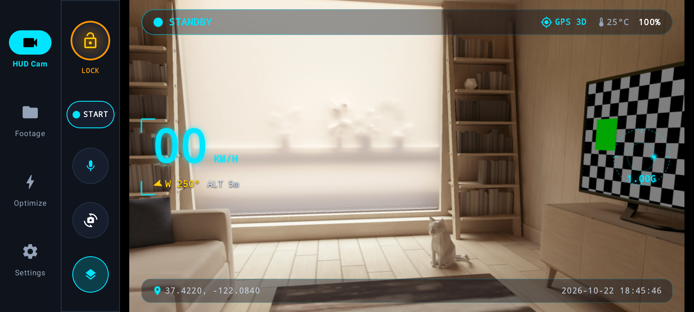
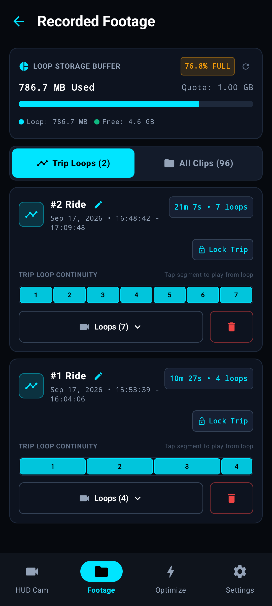
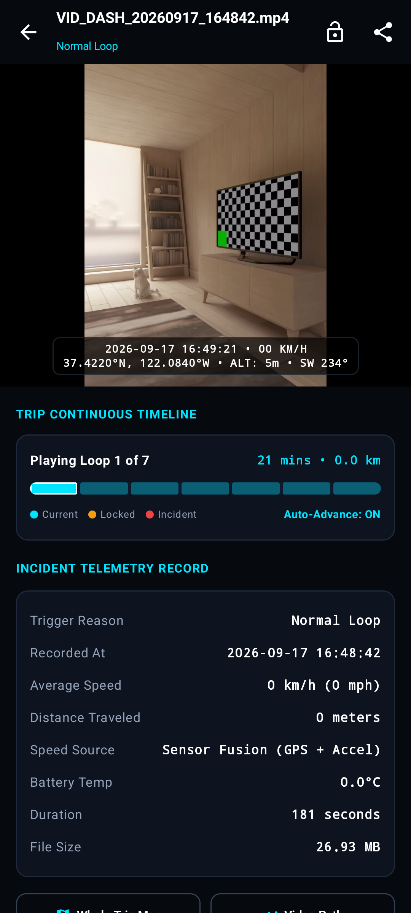
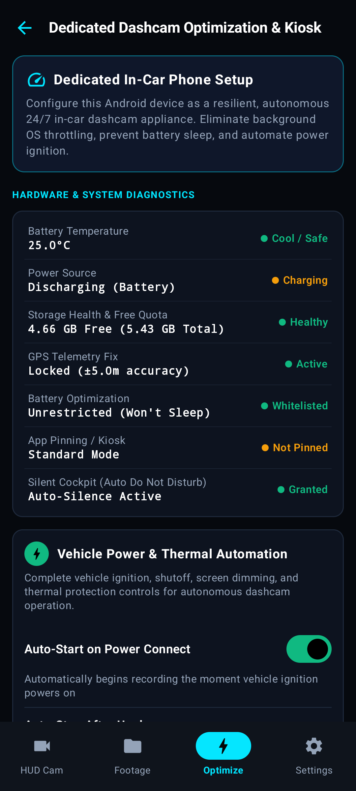

<div align="center">

# DashGuard Pro

**Use an old Android phone as a dashcam and a parked-car camera.**

[Download APK](https://github.com/roaxio/DashGuard-Pro/releases/latest) ·
[Get it with Obtainium](https://apps.obtainium.imranr.dev/redirect?r=obtainium://add/https://github.com/roaxio/DashGuard-Pro) ·
[Build from source](#build-from-source)

<p align="center">
  
</p>
<p align="center">
  
  
  
</p>

</div>

DashGuard Pro records the road in continuous video loops, protects crash incidents from being overwritten, and monitors the vehicle while parked. Live speed, heading, and G-force are displayed on screen and embedded into companion `.srt` subtitle files. Footage remains entirely offline on the device—no internet permission is requested.

## Features

<table>
<thead>
  <tr>
    <th width="20%">Category</th>
    <th width="40%">Highlights</th>
    <th width="40%">What It Does</th>
  </tr>
</thead>
<tbody>
  <tr>
    <td><b>🚗 Driving</b></td>
    <td>
      • 1, 3, or 5-min loops<br>
      • 1.6–3.5 G impact lock<br>
      • 15–300 s incident buffer<br>
      • 480p to 4K, up to 60 fps
    </td>
    <td>Continuous loop recording with automated FIFO storage pruning. Sudden shocks or manual locks preserve the incident file.</td>
  </tr>
  <tr>
    <td><b>🛰️ Telemetry</b></td>
    <td>
      • GPS speed (km/h or mph)<br>
      • Compass & GPS heading<br>
      • Real-time G-force<br>
      • Saved to <code>.srt</code> files
    </td>
    <td>Overlays driving metrics on the camera viewfinder and exports synchronized <code>.srt</code> subtitles or burnt-in fused telemetry videos.</td>
  </tr>
  <tr>
    <td><b>🛡️ Sentry Mode</b></td>
    <td>
      • Tier 1: Shock & sound standby<br>
      • Tier 2: 4 FPS optical motion<br>
      • Auto-arm on power loss<br>
      • Strobe / chime deterrents
    </td>
    <td>Guards the parked vehicle. Tier 2 optical motion automatically demotes to Tier 1 standby on low battery or high temperature to protect hardware.</td>
  </tr>
  <tr>
    <td><b>⚡ Power & Thermal</b></td>
    <td>
      • Auto-record on car charger<br>
      • 15% low-battery cutoff<br>
      • Warm auto-dim & cool-off<br>
      • True-black OLED saver
    </td>
    <td>Starts and stops with vehicle ignition. Protects the phone's lithium battery with thermal throttles and inactivity screen dimming.</td>
  </tr>
  <tr>
    <td><b>🎬 Gallery & Playback</b></td>
    <td>
      • Smart trip playback<br>
      • Whole-trip lock & protection<br>
      • Fused telemetry video export<br>
      • In-player pinch-to-zoom
    </td>
    <td>Automatically groups related driving loops into unified trip sessions with continuous playback, route mapping, and safety speed lock-out.</td>
  </tr>
</tbody>
</table>

## Permissions

| Permission | Why |
|---|---|
| Camera | Recording video |
| Microphone | Clip audio (can be turned off) and Sentry sound trigger |
| Location (precise) | Speed, heading, route and incident position |
| All files access / media access | Saving to and reading from a folder or SD card you choose |
| Notifications | The ongoing recording notification |
| Ignore battery optimizations | Recommended: prevents Android Doze from stopping recording during long drives |
| Do Not Disturb access | Optional: silence calls and alerts during active recording |

No internet permission is requested.

## Install

1. Download the latest `DashGuard-Pro-vX.Y.Z.apk` from [Releases](https://github.com/roaxio/DashGuard-Pro/releases/latest).
2. Open the APK on the phone and allow "Install unknown apps" when asked.
3. On first launch, grant camera, microphone and location. For long sessions, allow DashGuard Pro to ignore battery optimization; the app's optimization screen has phone-maker-specific tips.

Or add this repo to [Obtainium](https://github.com/ImranR98/Obtainium) to get updates automatically from GitHub Releases.

## Build from source

Needs JDK 17 or 21 and the Android SDK (compile SDK 37, target SDK 36, min SDK 24).

```bash
git clone https://github.com/roaxio/DashGuard-Pro.git
cd DashGuard-Pro
./gradlew assembleDebug        # app/build/outputs/apk/debug/app-debug.apk
```

> [!NOTE]
> Installing a debug APK over a release APK (or vice versa) will fail due to differing signature keys. Uninstall any existing release build first before installing a locally built debug APK.

## Security

Please report vulnerabilities privately through GitHub's
[Report a vulnerability](https://github.com/roaxio/DashGuard-Pro/security/advisories/new) form rather than in a public issue.

## License

[Apache License 2.0](LICENSE).
